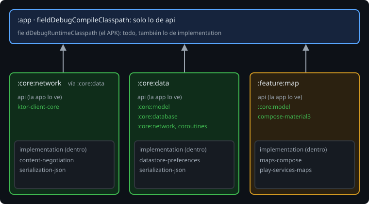

# Los módulos core: partir los datos

> Hasta la semana 32, `:data` lo tenía todo: las entidades y el DAO de Room, el cliente de Ktor, el repositorio que los junta, las preferencias de DataStore y el JSON de la semana 29. Son cuatro cosas que cambian por motivos distintos: la tabla cambia con una migración, la red cambia cuando cambia el servidor, y el repositorio cambia cuando cambian las reglas de la sincronización. Esta teoría parte `:core` y `:data` en cuatro módulos de Kotlin puro, sin Android, y cuenta qué se rompe por el camino.

## 🎯 Objetivos

- Partir un módulo por lo que cambia junto, no por el tipo de clase
- Decidir `api` o `implementation` mirando las firmas públicas
- Usar `internal` para lo que no sale del módulo
- Reconocer los errores nuevos: el *smart cast* entre módulos y las versiones que cambian

## 1. Cuatro módulos core

| Módulo | Paquete | Qué tiene | Depende de |
| --- | --- | --- | --- |
| `:core:model` | `dev.bitacora.model` | `Observation`, `Level`, `Position`, las reglas del dominio | nada |
| `:core:database` | `dev.bitacora.database` | `ObservationEntity`, `PendingChange`, el DAO, `BitacoraDatabase` y `schemas/` | `:core:model`, Room |
| `:core:network` | `dev.bitacora.network` | `RemoteObservation`, `ObservationApi`, `bitacoraClient`, `NetworkError` | Ktor |
| `:core:data` | `dev.bitacora.data` | `ObservationRepository`, `RoomObservationRepository`, `RefreshResult`, las preferencias y el JSON | los tres anteriores, DataStore |

Lo que decide dónde va cada cosa:

- **`:core:database` no sabe de la red, y `:core:network` no sabe de la base de datos.** Lo que traduce de una a otra (`RemoteObservation.toEntity()`) va en `:core:data`, que conoce a las dos.
- **`RefreshResult` va en `:core:data`**, junto a `ObservationRepository`, que lo devuelve. `NetworkError` va en `:core:network`, que es quien lo produce.
- **El builder `bitacora()`**, que importa el JSON de la semana 29 al crear la base de datos, va en `:core:data`: lee el JSON con `decode`, que es de `:core:data`. Si fuera en `:core:database`, la base de datos dependería de los datos, y los datos de la base de datos: un ciclo.

Cada módulo tiene su paquete. Kotlin deja que dos módulos compartan paquete, pero entonces un `import` no dice de qué módulo viene una clase, y dos clases con el mismo nombre chocan al juntarse en la app.

> 🔬 Medido: el esquema exportado de Room vive en una carpeta con el nombre completo de la clase, `schemas/dev.bitacora.data.BitacoraDatabase/`. Al mover `BitacoraDatabase` a `dev.bitacora.database`, la carpeta se renombra a `schemas/dev.bitacora.database.BitacoraDatabase/` y `MigrationTest` sigue en verde. El archivo de SQLite del móvil no guarda el nombre de la clase: no hace falta migración.

## 2. `api` o `implementation`, en la Bitácora



La regla de la semana 10 no cambia: **`api` si el tipo sale en una firma pública del módulo; `implementation` si solo se usa dentro.**

| Módulo | Dependencia | Cómo | Por qué |
| --- | --- | --- | --- |
| `:core:database` | `:core:model` | `api` | `ObservationEntity` tiene un `Level` |
| `:core:database` | `room3-runtime` | `api` | `BitacoraDatabase` es un `RoomDatabase` |
| `:core:network` | `ktor-client-core` | `api` | `bitacoraClient` devuelve un `HttpClient` |
| `:core:network` | `ktor-client-content-negotiation`, `kotlinx-serialization-json` | `implementation` | el JSON es cosa de la red |
| `:core:data` | `:core:database`, `:core:network` | `api` | el constructor de `RoomObservationRepository` recibe `BitacoraDatabase` y `ObservationApi`; `RefreshResult.Failed` lleva un `NetworkError` |
| `:core:data` | `datastore-preferences-core` | `implementation` | `SettingsRepository` no enseña nada de DataStore |

`:core:data` acaba con casi todo en `api`, y está bien: la app crea la base de datos y el cliente, y se los pasa al repositorio, así que tiene que verlos. Lo que importa es lo que **no** sale: la app no puede usar `ContentNegotiation` ni `Preferences`, y cambiar de biblioteca de JSON no la recompila.

> 🔬 Medido en el proyecto: el classpath de compilación de la app (`:app:dependencies --configuration fieldDebugCompileClasspath`) tiene `ktor-client-core` y no tiene `ktor-client-content-negotiation` ni `datastore-preferences-core`. El test `ModulesTest` de la raíz lo comprueba.

## 3. `internal`

Con un módulo por capa, `internal` vuelve a tener sentido. `ObservationsResponse`, el sobre JSON que manda el servidor (`{"observations": [...]}`), solo lo usa `ObservationApi`:

```kotlin
@Serializable
internal data class ObservationsResponse(val observations: List<RemoteObservation>)
```

Fuera de `:core:network` no existe. Los tests del mismo módulo sí lo ven: para Kotlin, `src/test` es parte del módulo.

## 4. El smart cast que deja de funcionar

Este código compilaba en `:data`, cuando la entidad y el repositorio estaban en el mismo módulo:

```kotlin
private fun ObservationEntity.toObservation() = Observation(
    code, level, description,
    if (latitude != null && longitude != null) Position(latitude, longitude) else null,
    photo,
)
```

Al pasar `ObservationEntity` a `:core:database` y dejar esta función en `:core:data`:

> 🔬 Medido con Kotlin 2.4.21: `Smart cast to 'Double' is impossible, because 'latitude' is a public API property declared in different module.`

Kotlin no puede fiarse de que `latitude`, leída dos veces, devuelva lo mismo: otro módulo puede cambiar su implementación (un `get()` calculado) sin que este se recompile. Dentro de un módulo lo sabe, porque se compila entero. El arreglo es leerla una vez:

```kotlin
private fun ObservationEntity.toObservation(): Observation {
    val latitude = latitude
    val longitude = longitude
    return Observation(code, level, description, if (latitude != null && longitude != null) Position(latitude, longitude) else null, photo)
}
```

## 5. Cada módulo resuelve sus versiones

Gradle resuelve las dependencias de cada módulo por separado. Mientras Ktor y DataStore estaban en el mismo `:data`, se resolvían juntos, y la versión más alta de cada biblioteca compartida ganaba para los dos. En módulos separados, cada uno se queda con la suya.

> 🔬 Medido: en `:data`, `okio` salía en 3.17.0, la que pide DataStore (`datastore-core-okio` 1.3.0). Al partir, `:core:network` no tiene DataStore, y su classpath resuelve `okio` 3.12.0, la que piden las dependencias de Ktor; `:core:data` sigue en 3.17.0. La verificación de dependencias (semana 14) falló la primera vez que se resolvió: `Dependency verification failed for configuration ':core:network:testRuntimeClasspath'`, hasta añadir `okio` 3.12.0. La teoría 03 enseña el mismo efecto, más grande, en el módulo del mapa.

No es un error: la app sigue resolviendo una sola versión de cada biblioteca, la más alta de todo su grafo. Pero un módulo puede compilar contra una versión más vieja que la que acaba en el APK. Si eso importa, el módulo declara la versión que necesita, o todos comparten un *platform* (semana 14).

## 6. Los tests, con su código

Cada test va al módulo de lo que prueba:

- `MigrationTest` va a `:core:database`, con `room3-testing` y los esquemas. Su segundo test abría la base de datos con el repositorio; ahora lee con el DAO, porque `:core:database` no ve el repositorio.
- `SyncTest`, `RoomTest`, `NetworkTest`, `SettingsTest` y `DataTest` van a `:core:data`: prueban el repositorio, que junta la base de datos y la red.
- Los de `:core:model` siguen donde estaban, con su paquete nuevo.

## Para recordar

- Se parte por lo que cambia junto: tabla, red, reglas de sincronización, dominio. Lo que traduce entre dos módulos va en el que conoce a los dos.
- Un paquete por módulo. Cuidado con `schemas/`, que lleva el nombre de la clase.
- `api` para lo que sale en las firmas; `implementation` para lo de dentro; `internal` para lo que ni siquiera se enseña.
- Entre módulos, Kotlin no hace smart cast de propiedades públicas: copia a un `val` local.
- Cada módulo resuelve sus versiones. Un módulo nuevo puede traer versiones nuevas a la verificación.
