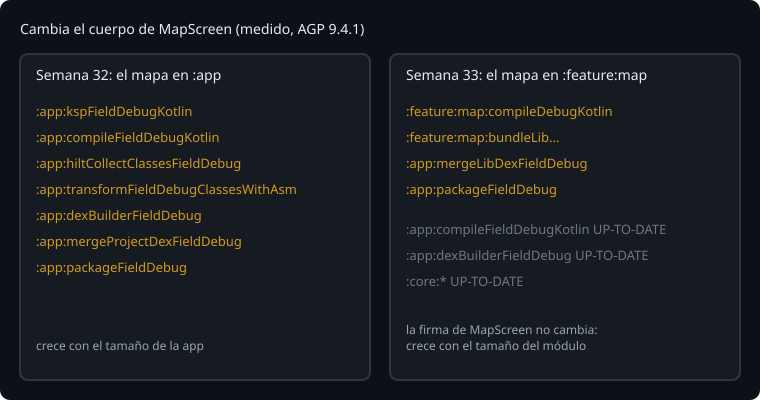

# Medir y probar el build modular

> La teoría 01 prometía builds que hacen menos. Esta teoría lo mide en la Bitácora: qué tareas se vuelven a ejecutar con tres cambios distintos, comparado con la Bitácora de un solo módulo de app de la semana 32. Cierra con lo que no cambia (el APK) y con una lista para partir el próximo módulo.

## 🎯 Objetivos

- Saber qué recompila un cambio según dónde está y si cambia la ABI
- Leer en la salida de Gradle qué ha hecho un build
- Comprobar que modularizar no cambia el APK
- Partir un módulo con una lista de comprobación

## 1. La ABI decide

Un módulo que depende de otro se compila contra su **ABI**: las firmas públicas (clases, funciones, propiedades, sus tipos), no el código de dentro. Si cambia el cuerpo de una función, el JAR de ese módulo cambia, pero su ABI no, y Gradle y el plugin de Kotlin dan por buena la compilación de los módulos de arriba. Si cambia una firma pública, todos los de arriba se recompilan.

Para verlo, `--console=plain` escribe cada tarea con su resultado. Lo que no pone `UP-TO-DATE`, `FROM-CACHE`, `NO-SOURCE` ni `SKIPPED` es lo que se ha ejecutado:

```bash
./gradlew :app:assembleFieldDebug --console=plain | grep '^> Task' | grep -vE 'UP-TO-DATE|NO-SOURCE|SKIPPED'
```

## 2. Tres cambios, medidos

> 🔬 Medido en la Bitácora de esta semana, con AGP 9.4.1, Kotlin 2.4.21 y Gradle 9.8.2, después de un `assembleFieldDebug` completo.



**Cambia el cuerpo de `MapScreen`** (el `padding` de la columna):

```
> Task :feature:map:compileDebugKotlin
> Task :feature:map:bundleLibCompileToJarDebug
> Task :feature:map:bundleLibRuntimeToJarDebug
> Task :app:mergeLibDexFieldDebug
> Task :app:packageFieldDebug
```

`:app:compileFieldDebugKotlin` sale `UP-TO-DATE`: la firma de `MapScreen` no ha cambiado. Ni KSP, ni Hilt, ni el dex de la app se repiten: el código del mapa se convierte a dex por su lado (`mergeLibDex`).

**Cambia el cuerpo de una función de `:core:network`** (`ObservationApi.delete`): se ejecutan `:core:network:compileKotlin` y `:core:network:jar`, y `:core:data:compileKotlin` y `:app:compileFieldDebugKotlin` salen `UP-TO-DATE`.

**Cambia la ABI de `:core:model`** (una función pública nueva): se recompila todo lo que está encima. `:core:model`, `:core:database` (con KSP de Room), `:core:data`, `:feature:map` y la app (con KSP de Hilt, `hiltCollectClasses` y la transformación de clases de Hilt).

**El mismo cambio en `MapScreen`, en la Bitácora de la semana 32**, donde el mapa estaba en la app:

```
> Task :app:kspFieldDebugKotlin
> Task :app:compileFieldDebugKotlin
> Task :app:hiltCollectClassesFieldDebug
> Task :app:transformFieldDebugClassesWithAsm
> Task :app:dexBuilderFieldDebug
> Task :app:mergeProjectDexFieldDebug
> Task :app:packageFieldDebug
```

KSP de Hilt, la compilación de la app (incremental, pero de la app entera), Hilt y el dex de la app. Con el daemon caliente, las dos versiones tardan 2 o 3 segundos: la Bitácora es pequeña. Lo que cambia es la forma: en la modular, el trabajo crece con el tamaño del módulo que cambias; en la de un módulo, con el tamaño de la app.

Lo que sale de aquí:

- **Lo que cambia mucho va arriba, y lo que cambia poco, abajo.** Un cambio en `:core:model` lo recompila todo. Por eso `:core:model` es pequeño y estable.
- **`api` agranda la ABI.** Lo que un módulo expone con `api` forma parte de lo que ven los de arriba: un cambio de versión de una dependencia `api` les cambia el classpath, y los recompila. Con `implementation`, no.
- **KSP y Hilt cuestan en el módulo que los aplica.** En la Bitácora, solo la app y `:core:database`.

## 3. En paralelo

Con `org.gradle.parallel=true`, Gradle ejecuta a la vez las tareas de módulos que no dependen el uno del otro. En la Bitácora, `:core:network` y `:core:database` no se conocen, ni `:feature:map` y `:core:data`: en un build limpio, sus compilaciones pueden ir a la vez. En un grafo profundo y estrecho (cada módulo depende del anterior), no hay nada que solapar. En uno ancho, sí.

`--dry-run` (`-m`) enseña las tareas que se ejecutarían, sin ejecutarlas:

```bash
./gradlew :feature:map:testDebugUnitTest -m
```

Prueba el mapa sin compilar la app, ni Hilt, ni Room.

## 4. Lo que no cambia

> 🔬 Medido: el APK `field` de release pesa 12 668 263 bytes, 12,67 MB, como en la semana 32. Los módulos se juntan al construir la app, y R8 trata el código del mapa igual que antes.

Tampoco cambian la app ni sus tests: los 100 de `field` y los 88 de `demo` siguen en verde, y el ViewModel no se entera. Lo que sí cambia es dónde vive cada test:

| Módulo | Tests |
| --- | --- |
| `:core:model` | 10 |
| `:core:database` | 2 (`MigrationTest`) |
| `:core:data` | 37 |
| `:feature:map` | los nuevos de `MapScreenTest` |
| `:app` | 100 (`field`) y 88 (`demo`) |
| raíz | 13 de `BuildTest` y 6 de `ModulesTest` |

> 🔬 Medido también: una vez, en un `./gradlew build` completo, `:app:lintAnalyzeFieldDebugUnitTest` falló con `Unexpected failure during lint analysis of AccessibilityTest.kt (this is a bug in lint ...)`. Repetido, en verde, y no volvió a pasar. Si te pasa, repite la tarea sola antes de buscar otra cosa.

## 5. Lista para partir un módulo

1. **¿Cambia junto?** Lo que va en el módulo cambia por el mismo motivo. Lo que traduce entre dos módulos va en el que conoce a los dos.
2. **Paquete y namespace** propios. En Room, la carpeta de `schemas/` lleva el nombre de la clase.
3. **Kotlin puro si se puede.** `bitacora.kotlin-library`: sin recursos ni manifiesto, se prueba en la JVM sin Robolectric.
4. **`api` lo de las firmas, `implementation` lo demás, `internal` lo de dentro.** Comprueba con `dependencies --configuration ...CompileClasspath` lo que ve el de arriba.
5. **Los recursos y el manifiesto**, con el módulo. Desde fuera, con su `R`.
6. **Los tests**, con lo que prueban. Una biblioteca de Android, con `testOptions.targetSdk`.
7. **La verificación de dependencias**: cada módulo resuelve su grafo, y pueden entrar versiones nuevas. `--write-verification-metadata` y revisar lo que entra.
8. **Las reglas del grafo**: que el módulo aplique el convention plugin que las comprueba.
9. **Mide**: un cambio de cuerpo en el módulo nuevo no debería recompilar la app.

## Para recordar

- Un módulo se compila contra la ABI de los de abajo: un cambio de cuerpo no sube, uno de firma lo recompila todo encima.
- Medido en la Bitácora: un cambio en el cuerpo del mapa compila el mapa y empaqueta; en la de un módulo, repetía KSP, Hilt y el dex de la app.
- Lo estable abajo, pequeño; lo que cambia, arriba. `api` agranda lo que recompila un cambio.
- El APK es el mismo: modularizar cambia el build, no la app.
