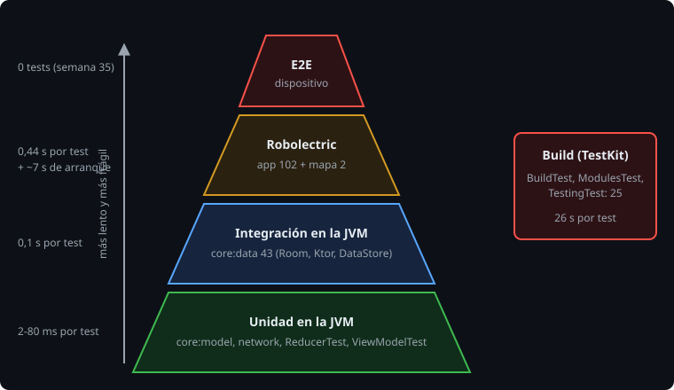

# La pirámide de tests de la Bitácora

> Desde la semana 9, cada semana ha añadido tests a la Bitácora. Hoy hay casi 300 en siete módulos, y se ejecutan con `./gradlew build`. Esta teoría las ordena: qué prueba cada nivel, cuánto cuesta y dónde va un test nuevo. Los tiempos están medidos.

## 🎯 Objetivos

- Distinguir los niveles de la pirámide y lo que prueba cada uno
- Saber cuánto cuesta un test en cada nivel de la Bitácora
- Decidir dónde va un test nuevo
- Saber qué no merece un test

## 1. La pirámide

La idea de la pirámide de tests es de Mike Cohn: muchos tests pequeños y rápidos en la base, menos tests en el medio y pocos arriba, que son los lentos y los que se rompen por motivos ajenos al cambio. En Android, la [guía de tests](https://developer.android.com/training/testing/fundamentals) la parte en tres niveles:

| Nivel | Qué prueba | Dónde corre | En la Bitácora |
| --- | --- | --- | --- |
| **Unidad** | Una función o una clase, sin Android | La JVM | `:core:*`, `ReducerTest`, `ViewModelTest` |
| **Integración** | Varias piezas juntas: Room con su SQLite, Ktor con su JSON, una pantalla con su ViewModel | La JVM (con SQLite empaquetado, `MockEngine` o Robolectric) | `RoomTest`, `SyncTest`, `NetworkTest`, `MainActivityTest` |
| **Extremo a extremo** | La app instalada, en un dispositivo | Un móvil o un emulador | Ninguno todavía (semana 35) |

La Bitácora tiene además un cuarto tipo, que no sale en la pirámide de Android: los tests del **build**. `BuildTest`, `ModulesTest` y, esta semana, `TestingTest` copian el proyecto entero y ejecutan Gradle dentro con TestKit.

## 2. Lo que cuesta cada nivel

> 🔬 Medido en la Bitácora de esta semana con `./gradlew build` (AGP 9.4.1, Robolectric 4.17, Gradle 9.8.2). Es la suma de los tiempos de `build/test-results/`, sin contar la compilación.

| Módulo o clase | Tests | Tiempo | Por test |
| --- | --- | --- | --- |
| `:core:model` | 10 | 0,8 s | 0,08 s |
| `:core:data` (Room, Ktor, DataStore) | 43 | 4,2 s | 0,1 s |
| `ReducerTest`, en la app, sin Robolectric | 6 | 0,014 s | 2 ms |
| `ViewModelTest`, en la app, sin Robolectric | 6 | 0,05 s | 8 ms |
| `:feature:map`, con Robolectric | 2 | 15,1 s | 7,5 s |
| La app, `testFieldDebugUnitTest` | 102 | 45 s | 0,44 s |
| La raíz (TestKit) | 25 | 645 s | 26 s |

Lo que se lee en la tabla:

- **Robolectric cuesta al arrancar.** `:feature:map` tiene dos tests y tarda 15 s: el primero carga `android-all` y el tema. En la app, ese arranque se reparte entre 102 tests. `AccessibilityTest` se lleva 20 s porque es la primera clase que lo paga.
- **Un test de la JVM en un módulo de Android es tan rápido como uno de `:core`.** `ReducerTest` está en la app y no usa Robolectric: 2 ms por test. Lo lento es Robolectric, no el módulo de Android.
- **TestKit es el nivel más caro.** Cada test copia el proyecto y arranca un Gradle. Cuesta lo que un test extremo a extremo, y por eso hay pocos.

## 3. Dónde va un test nuevo

Hay que escribirlo en el nivel más bajo que pueda fallar por el motivo que interesa:

- **«A-10 va después de A-2».** Es una regla de la consulta de Room, así que va en `:core:data`, contra Room, sin pantalla. Si se pusiera en la app, cada vez que se ejecuta arrancaría Robolectric para probar una consulta.
- **«El botón Actualizar se desactiva mientras se pide».** El estado se prueba en `ViewModelTest`, que es de la JVM. Que el botón lea ese estado se prueba con Robolectric (`RefreshScreenTest`), una sola vez.
- **«Los textos del mapa son de `:feature:map`».** Es un hecho del build y solo se puede ver construyendo, así que va en TestKit.

Cada nivel tiene su motivo para fallar. Un test de unidad falla por la lógica. Uno de integración falla además porque las piezas no encajan, por ejemplo cuando el JSON del servidor no casa con `RemoteObservation`. Uno extremo a extremo falla además por el dispositivo, la red o el tiempo. Cuanto más arriba está un test, más motivos tiene para fallar sin que el cambio tenga la culpa.

## 4. El trofeo y otras formas

Kent C. Dodds propone un trofeo en lugar de una pirámide: más tests de integración que de unidad, porque dan más confianza por test. En Android, los de integración de la JVM (Room con SQLite empaquetado, Ktor con `MockEngine`, Compose con Robolectric) son casi tan rápidos como los de unidad. Por eso la Bitácora tiene más tests de integración que la pirámide clásica. Lo que de verdad importa no es la forma, sino dos reglas:

- Los tests lentos y frágiles, pocos.
- Ningún nivel repite lo que prueba el de abajo.

## 5. Lo que no merece un test

- **Lo que garantiza el compilador.** Que `Observation` tiene un `code` no se prueba.
- **El código de otros.** Que Room guarda una fila ya lo prueba Room. En la Bitácora se prueban la consulta y la migración, que son nuestras.
- **Las líneas por las líneas.** Un test que llama a una función sin comprobar nada sube la cobertura y no prueba nada (teoría 06).
- **Los detalles que cambian sin cambiar el comportamiento.** Cuántas veces se llama a un método interno, por ejemplo: eso se rompe al refactorizar (teoría 02).

## Para recordar

- Unidad, integración y extremo a extremo; en la Bitácora, también los tests del build con TestKit.
- Medido: 2 ms un test de la JVM, 0,44 s uno de Robolectric (más un arranque de unos 7 s) y 26 s uno de TestKit.
- Un test va en el nivel más bajo en el que puede fallar por el motivo que interesa.
- Lo lento es Robolectric, no el módulo de Android: la lógica de una pantalla se prueba en la JVM.
