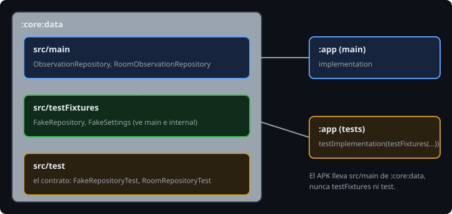

# Compartir fakes entre módulos: test fixtures

> Desde la semana 33, `FakeRepository` imita algo que vive en `:core:data`, pero está en `app/src/test`. Si mañana `:feature:map` necesita un repositorio de mentira, tendría que copiarlo, y cada copia mentiría a su manera. El plugin `java-test-fixtures` de Gradle le da a cada módulo un tercer conjunto de fuentes, `testFixtures`, para el código de test que otros módulos pueden usar.

## 🎯 Objetivos

- Crear los `testFixtures` de un módulo de Kotlin y usarlos desde otro
- Saber qué ve el código de `testFixtures` y quién lo ve
- Comprobar que los fakes no acaban en el APK

## 1. Tres conjuntos de fuentes

| Carpeta | Qué va | Quién lo ve |
| --- | --- | --- |
| `src/main` | El código del módulo | Quien depende del módulo |
| `src/test` | Sus tests | Nadie más |
| `src/testFixtures` | Código para tests: fakes, constructores de datos, reglas | Sus tests y los tests de quien lo pida |



En `core/data/build.gradle.kts`:

```kotlin
plugins {
    id("bitacora.kotlin-library")
    alias(libs.plugins.kotlin.serialization)
    `java-test-fixtures`
}
```

El plugin viene con Gradle, así que no hay versión que fijar ni nada que verificar. Crea el conjunto `testFixtures` y estas tareas: `compileTestFixturesKotlin`, `testFixturesJar` y las configuraciones `testFixturesApi` y `testFixturesImplementation`. Además, el plugin de Kotlin compila esa carpeta.

## 2. Usarlos desde otro módulo

En la app:

```kotlin
testImplementation(testFixtures(project(":core:data")))
```

`testFixtures(...)` pide la variante de *test fixtures* de `:core:data`. Es un JAR aparte, con su propio grafo: depende del código principal de `:core:data` y, por eso, trae también sus dependencias `api`.

> 🔬 Medido en la Bitácora: una app de Android (AGP 9.4.1) usa sin más los `testFixtures` de un módulo de Kotlin puro en `testFieldDebugUnitTest`. Los 102 tests de field y los 90 de demo siguen en verde, con `import dev.bitacora.data.testing.FakeRepository`.

Los tests del propio `:core:data` los ven sin declarar nada, porque el plugin los añade a `testImplementation`. Así funciona `FakeRepositoryTest`, que está en `core/data/src/test`.

El paquete es `dev.bitacora.data.testing`. El sufijo `.testing` hace que un `import` de un fake en el código de producción se vea enseguida (Now in Android usa el mismo nombre para su módulo `core:testing`).

## 3. Qué ve el código de `testFixtures`

- **El código principal del módulo**, con sus dependencias `api`. `FakeRepository` implementa `ObservationRepository` y usa `MutableStateFlow`, que llega por `:core:model`.
- **Lo `internal` del módulo.** En Kotlin, `testFixtures` es parte del mismo módulo, como `test`.

> 🔬 Medido con Kotlin 2.4.21: una clase de `testFixtures` llama a una función `internal` del código principal y compila.

- **Nada de lo que tenga `src/test`.** Si un fake necesita algo de JUnit o de `kotlinx-coroutines-test`, se declara en `testFixturesImplementation`. Los de la Bitácora no lo necesitan.

## 4. Lo que no llega al APK

`testImplementation` solo entra en el classpath de los tests: ni el JAR de los fixtures ni Turbine aparecen en `fieldReleaseRuntimeClasspath`. `TestingTest.theFakesAreNotInTheApk` lo comprueba con `:app:dependencies`.

Un error que conviene evitar: poner `implementation(testFixtures(...))` en lugar de `testImplementation(...)`. Compila, y mete los fakes en el APK.

## 5. Y una biblioteca de Android

AGP también tiene test fixtures para los módulos de Android. No usa el plugin de Gradle, sino `android { testFixtures { enable = true } }`.

> 🔬 Medido con AGP 9.4.1 en `:feature:map`: aparecen las variantes `debugTestFixtures` y `releaseTestFixtures`, cada una con su AAR (`bundleDebugTestFixturesAar`).

La Bitácora no los necesita, porque sus fakes son de módulos de Kotlin puro. Si un día `:feature:map` quisiera compartir algo propio de Android con otros módulos, por ejemplo una regla de Compose, sería así.

## 6. Lo que va en `testFixtures` y lo que no

- **Sí:** los fakes de las interfaces del módulo (`FakeRepository` y `FakeSettings`, junto a `ObservationRepository` y `SettingsRepository`) y los datos de ejemplo que usan varios módulos.
- **No:** el contrato. Es un test del módulo, no una herramienta para otros, y necesita JUnit. Va en `src/test`.
- **No:** un fake que solo usa un test. Que se quede en ese test hasta que lo necesite otro.

## Para recordar

- `java-test-fixtures` añade `src/testFixtures`: código de test que otros módulos piden con `testImplementation(testFixtures(project(":...")))`.
- Ve lo principal y lo `internal` de su módulo, pero no `src/test`.
- Los fakes van junto a lo que imitan: un solo `FakeRepository`, en `:core:data`, comprobado por el contrato.
- Con `testImplementation` no llegan al APK; con `implementation`, sí.
