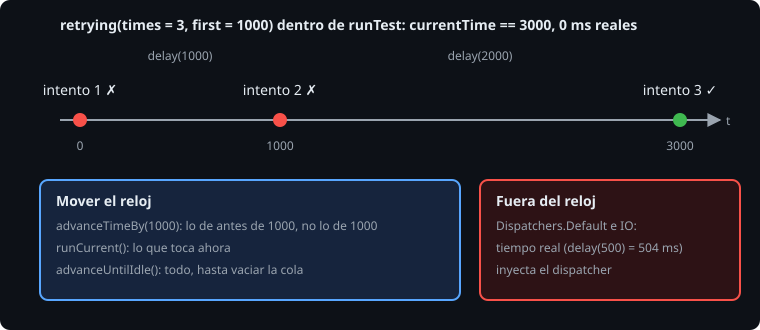

# Corrutinas en los tests: runTest y el tiempo virtual

> Los tests de la Bitácora usan `runTest` desde la semana 28, y `NetworkTest` comprueba un tiempo agotado de 15 s en un test que dura milisegundos. Esta teoría explica cómo: el `TestScope`, los dos `TestDispatcher`, el reloj virtual y lo que pasa cuando algo se escapa de él. Todo lo que se cuenta está medido.

## 🎯 Objetivos

- Explicar qué hace `runTest` y su reloj virtual
- Elegir entre `StandardTestDispatcher` y `UnconfinedTestDispatcher`
- Mover el reloj con `advanceTimeBy`, `runCurrent` y `advanceUntilIdle`
- Probar código que usa `Dispatchers.Main`, `viewModelScope` o un `Dispatchers.IO` fijo
- Reconocer los errores de `runTest`

> 🔬 Todo lo de esta teoría está medido con kotlinx-coroutines-test 1.11.0 y Turbine 1.2.1, en la JVM.

## 1. `runTest`

```kotlin
@Test
fun aSlowServerTimesOut() = runTest {
    val start = currentTime
    // ... el servidor tarda más que REQUEST_TIMEOUT
    assertEquals(REQUEST_TIMEOUT, currentTime - start)
}
```

`runTest` crea un `TestScope` con un `TestCoroutineScheduler`, que es un reloj virtual y una cola de tareas, y ejecuta el bloque como una corrutina. Cuando el bloque llama a `delay`, el planificador no espera: adelanta el reloj hasta la siguiente tarea. Un `delay(10_000)` dentro de `runTest` termina en 0 ms reales con `currentTime == 10000`.

`runTest` también espera a que terminen los hijos que el bloque ha lanzado, y hace fallar el test si alguno lanza una excepción:

```kotlin
@Test fun f() = runTest { launch { error("boom") } }   // falla con IllegalStateException: boom
```

## 2. Los dos `TestDispatcher`

| | `StandardTestDispatcher` | `UnconfinedTestDispatcher` |
| --- | --- | --- |
| Un `launch` | Se pone en la cola | Empieza al momento, hasta su primera suspensión |
| ¿Estable? | Sí | `@ExperimentalCoroutinesApi` |
| El de `runTest` | Sí, por defecto | Si se le pasa |

> 🔬 Medido:
>
> ```kotlin
> launch { log += "standard" }
> log += "after-launch"
> launch(UnconfinedTestDispatcher(testScheduler)) { log += "unconfined" }
> log += "after-unconfined"
> advanceUntilIdle()
> // log == [after-launch, unconfined, after-unconfined, standard]
> ```

Con `Standard` controlas cuándo pasa cada cosa. Así se prueba, por ejemplo, el estado intermedio de `refreshing`: lanzas la petición, miras el estado y después dejas que conteste. Con `Unconfined` todo pasa en el orden en que se escribe, que es cómodo para un ViewModel cuyos `launch` deben haber corrido cuando el test mira `state.value`. Por eso `ViewModelTest` usa `Dispatchers.setMain(UnconfinedTestDispatcher())`.

**Un solo reloj.** Todos los `TestDispatcher` de un test tienen que compartir el planificador (`StandardTestDispatcher(testScheduler)`). Si uno se crea con su propio planificador, `advanceUntilIdle()` no lo mueve:

> 🔬 Medido: `CoroutineScope(StandardTestDispatcher()).launch { ran = true }` seguido de `advanceUntilIdle()` deja `ran == false`.

`runTest` toma el planificador de `Dispatchers.Main` si se ha cambiado con `setMain` y es un `TestDispatcher`. Por eso `ViewModelTest` comparte reloj sin pasar nada.

> 🔬 Medido: después de `Dispatchers.setMain(UnconfinedTestDispatcher())`, el dispatcher de `runTest` tiene el mismo `scheduler` que el de `Main`.

## 3. Mover el reloj

| Función | Qué hace |
| --- | --- |
| `runCurrent()` | Ejecuta lo que toca ahora, sin mover el reloj |
| `advanceTimeBy(ms)` | Adelanta el reloj `ms` y ejecuta lo que toca **antes** de ese momento |
| `advanceUntilIdle()` | Ejecuta todo hasta que la cola queda vacía, adelantando el reloj lo que haga falta |
| `currentTime` | La hora virtual, en ms |

`advanceTimeBy` no incluye el instante final:

> 🔬 Medido: con `launch { delay(1000); done = true }`, después de `advanceTimeBy(1000)` sigue `done == false`; después de `runCurrent()`, `true`. `currentTime` es 1000 en los dos casos.

En la versión 1.11, `currentTime`, `advanceTimeBy`, `advanceUntilIdle`, `runCurrent` y `UnconfinedTestDispatcher` necesitan `@OptIn(ExperimentalCoroutinesApi::class)`; `runTest` y `StandardTestDispatcher`, no. Con `allWarningsAsErrors` de la Bitácora, olvidar el `@OptIn` no compila.

## 4. Lo que se escapa del reloj

El reloj virtual solo controla las corrutinas que corren en un `TestDispatcher`. Lo que corre en `Dispatchers.Default` o en `Dispatchers.IO` lleva el tiempo de verdad:

> 🔬 Medido: `withContext(Dispatchers.Default) { delay(500) }` dentro de `runTest` tarda 504 ms reales, y `currentTime` sigue en 0.

En la Bitácora hay dos sitios así:

- **`bitacora()`** fija `setQueryCoroutineContext(Dispatchers.IO)` para Room. Las consultas corren en otro hilo y el `Flow` de Room emite desde ahí. Los tests que lo leen esperan de verdad (con `first()` o con Turbine, teoría 05) y no miden con `currentTime`.
- **`DataStoreSettingsRepository`** recibe su `scope`, que por defecto es `CoroutineScope(Dispatchers.IO + SupervisorJob())`. Es un parámetro con valor por defecto, así que un test puede pasar el suyo.

La regla es **inyectar el dispatcher**: si una clase decide su propio `Dispatchers.IO` y no deja cambiarlo, el test no puede llevarla al reloj virtual. `MockEngine` de Ktor tiene el mismo problema y la misma solución: `dispatcher = StandardTestDispatcher(testScheduler)` en `NetworkTest`, para que el tiempo agotado de 15 s sea virtual.

## 5. `Dispatchers.Main` y `viewModelScope`

`viewModelScope` usa `Dispatchers.Main.immediate`, y en la JVM no hay hilo principal:

> 🔬 Medido, sin `setMain`:
>
> ```
> IllegalStateException: Dispatchers.Main was accessed when the platform dispatcher was absent and the test
> dispatcher was unset. Please make sure that Dispatchers.setMain() is called before accessing Dispatchers.Main ...
> ```

Por eso `@Before` hace `Dispatchers.setMain(...)` y `@After` hace `Dispatchers.resetMain()`. `RefreshTest` crea el ViewModel con `by lazy`: si se crea antes de `setMain`, su `viewModelScope` ya ha tomado el `Main` sin cambiar. Con Robolectric no hace falta, porque Robolectric tiene un `Main` (su looper).

## 6. `backgroundScope` y los que no acaban

Un `collect` de un `StateFlow` no termina nunca. Si se lanza con `launch` dentro de `runTest`, el test no puede acabar:

> 🔬 Medido con `runTest(timeout = 2.seconds) { launch { MutableStateFlow(0).collect { } } }`:
>
> ```
> UncompletedCoroutinesError: After waiting for 2s, there were active child jobs: ["coroutine#18":StandaloneCoroutine{Active}@...].
> Use `TestScope.backgroundScope` to launch the coroutines that need to be cancelled when the test body finishes
> ```

Un bucle `while (true) delay(1000)` da el mismo error: el reloj virtual avanza sin fin hasta que se acaba el tiempo real. `backgroundScope` es un ámbito que `runTest` cancela al terminar el bloque. Ahí van los que escuchan para siempre, como el `collect` de `RoomTest` en la semana 30 o el `Poller` del ejercicio 01.

## 7. El límite de tiempo

`runTest` tiene un límite de **tiempo real**, no virtual:

> 🔬 Medido: sin `timeout`, un bloque que espera en `Dispatchers.Default` falla a los 66 s con `UncompletedCoroutinesError: After waiting for 1m, the test body did not run to completion`. Con `runTest(timeout = 1.seconds)`, al segundo.

Un minuto es mucho para un test que se ha quedado colgado. Si un test espera algo de otro hilo (Room, DataStore), conviene pasarle un `timeout` corto.



## Para recordar

- `runTest` tiene un reloj virtual: `delay` no espera y `currentTime` dice cuánto ha pasado.
- `StandardTestDispatcher` pone en cola y `UnconfinedTestDispatcher` ejecuta al momento. Un solo planificador para todos.
- `advanceTimeBy` no incluye el instante final: después, `runCurrent()`.
- Lo que corre en `Default` o en `IO` lleva tiempo real. Por eso se inyecta el dispatcher.
- `setMain` para `viewModelScope`; `backgroundScope` para lo que no acaba; el límite de 1 min es de tiempo real.
