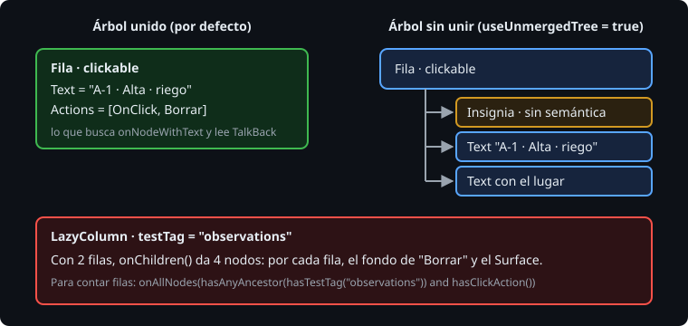

# El árbol semántico: lo que ven los tests

> Un test de Compose no ve píxeles ni funciones `@Composable`. Ve el **árbol semántico**: los nodos que también lee TalkBack, con su texto, su papel, su estado y lo que se puede hacer con ellos. Esta teoría explica cómo es ese árbol en la Bitácora, cómo se mira, qué hacer con un control que no tiene semántica y cómo llegan los `testTag` a las herramientas que miran desde fuera de la app.

## 🎯 Objetivos

- Leer el árbol semántico de una pantalla con `printToLog`
- Distinguir el árbol unido del árbol sin unir
- Elegir entre texto, descripción, papel y `testTag` para encontrar un nodo
- Dar semántica a un control dibujado a mano
- Exponer los `testTag` como `resource-id` con `testTagsAsResourceId`



## 1. Qué hay en un nodo

Cada `Modifier` que añade semántica (`clickable`, `semantics { }`, `Text`, `testTag`) deja propiedades en un nodo. Para verlas, en cualquier test:

```kotlin
rule.onNodeWithTag("rating").printToLog("ARBOL")      // al log (logcat, o la salida del test en Robolectric)
println(rule.onNodeWithTag("rating").printToString()) // a un String
```

> 🔬 Medido en el ejercicio 01, con la semántica ya puesta:
>
> ```
> Node #18 at (l=0.0, t=0.0, r=200.0, b=40.0)px, Tag: 'rating'
> ContentDescription = '[Estado de la parcela]'
> ProgressBarRangeInfo = 'ProgressBarRangeInfo(current=3.0, range=1.0..5.0, steps=3)'
> StateDescription = '3 de 5'
> Actions = [SetProgress]
> ```

Lo que hay en el nodo es lo que se puede buscar (`hasStateDescription("3 de 5")`), comprobar (`assert(...)`) y hacer (`performSemanticsAction(SetProgress)`). Lo que no está en el nodo no existe para el test. Tampoco existe para TalkBack.

## 2. El árbol unido y el árbol sin unir

`clickable`, `Button` y `semantics(mergeDescendants = true)` **unen** a sus descendientes: el nodo del botón se queda con el texto de su `Text`, y TalkBack lee el conjunto de una vez. Los finders buscan por defecto en el árbol unido:

```kotlin
rule.onNodeWithText("A-1 · Alta · riego").performClick()                      // la fila entera: es clickable
rule.onNodeWithText("A-1 · Alta · riego", useUnmergedTree = true)             // el Text de dentro, solo
```

La fila de la Bitácora (`ObservationRow`) es `clickable`. En el árbol unido es un solo nodo, con el texto de la línea y la acción de borrar (semana 26). En el árbol sin unir, sus `Text` siguen siendo nodos aparte. Y un nodo vaciado con `clearAndSetSemantics {}`, como la insignia, desaparece de lo que lee TalkBack, pero sigue en el árbol sin unir de los tests (medido en la semana 26).

Regla práctica: busca como lo haría una persona, en el árbol unido. Baja al árbol sin unir solo para comprobar una pieza que se une con otras.

## 3. Hijos que no son lo que parecen

> 🔬 Medido en el proyecto. Con dos observaciones, la lista tiene **cuatro** hijos:
>
> ```
> Expected '2' nodes but found '4' nodes that satisfy: ((TestTag = 'observations').children)
> 1) Node #127 ... Shape = 'RectangleShape'
> 2) Node #130 ... IsContainer = 'true'
> ...
> ```

Cada fila va dentro de un `SwipeToDismissBox` (semana 25): un nodo es el fondo de «Borrar» y el otro el `Surface` de la fila. `onChildren()` cuenta la estructura de la pantalla, no lo que ve la persona usuaria. Para contar filas, busca lo que las define: lo que se puede pulsar dentro de la lista.

```kotlin
rule.onAllNodes(hasAnyAncestor(hasTestTag("observations")) and hasClickAction()).assertCountEquals(2)
```

Un `LazyColumn` solo compone lo que cabe en la pantalla (semana 22). Si hay más filas de las que caben, hay que contar de otra forma o desplazar la lista primero.

## 4. Cómo encontrar un nodo

| Por | Finder | Cuándo |
| --- | --- | --- |
| Texto | `onNodeWithText("Compartir")` | Casi siempre: es como lo encuentra una persona. Si cambia el texto, el test tiene que cambiar |
| Descripción | `onNodeWithContentDescription("La foto")` | Imágenes e iconos, que no tienen texto |
| Papel y estado | `onNode(hasClickAction() and hasStateDescription("3 de 5"))` | Controles propios, interruptores, valoraciones |
| `testTag` | `onNodeWithTag("observations")` | Lo que no tiene texto ni papel propio: un contenedor, una lista, un mapa |

`testTag` no lo ve nadie más que los tests. Es el último recurso: un test que solo busca por tags puede pasar con una pantalla que nadie podría usar. En la Bitácora hay uno, en la lista, porque una lista no tiene texto propio.

Los textos de la Bitácora están en español (`values/`) y Robolectric arranca en inglés de EE. UU.: los tests llevan `@Config(qualifiers = "+es")` (semana 16).

## 5. Un control sin semántica

La valoración del ejercicio 01 son cinco círculos dibujados con `Canvas`, y un toque se recoge con `pointerInput`. No hay un `Button` ni un `Slider` debajo, así que Compose no sabe qué es.

> 🔬 Medido: sin semántica, `performTouchInput { click(...) }` funciona, porque el toque llega por coordenadas. Pero `performSemanticsAction(SetProgress)` falla con `the node is missing [SetProgress]`, y `hasStateDescription` no encuentra nada. Para TalkBack es una caja vacía.

Se arregla diciendo qué es, en el `Modifier`:

```kotlin
Modifier.semantics {
    contentDescription = label                                  // de qué es: «Estado de la parcela»
    stateDescription = "$value de 5"                            // dónde está
    progressBarRangeInfo = ProgressBarRangeInfo(value.toFloat(), 1f..5f, steps = 3)
    setProgress { target ->                                     // los gestos de subir y bajar de TalkBack
        onValueChange(target.roundToInt().coerceIn(1, 5))
        true
    }
}
```

`steps` es el número de valores que hay **entre** los extremos (2, 3 y 4): 3, no 5. El test de la semántica y el de accesibilidad son el mismo test. Si el test encuentra el control por su papel, TalkBack también puede.

## 6. Los tags fuera de la app

Los tests de Compose miran el árbol desde dentro de la app. UiAutomator (y Macrobenchmark, en la semana 36) miran desde fuera, como un servicio de accesibilidad, y buscan por `resource-id`. En las vistas, el `resource-id` es el `android:id`. Compose no tiene ids: hay que pedir que los `testTag` hagan ese papel.

```kotlin
NavDisplay(
    // ...
    modifier = Modifier.semantics { testTagsAsResourceId = true },   // vale para todo lo que hay debajo
)
```

> 🔬 Medido en el proyecto: con el modificador puesto, el nodo tiene `TestTagsAsResourceId = true`, y un test lo encuentra con `SemanticsMatcher.expectValue(SemanticsPropertiesAndroid.TestTagsAsResourceId, true)`. Que UiAutomator encuentre la lista por `observations` necesita un dispositivo, y se verá en la semana 36.

## ⚠️ Errores comunes

| Error | Qué pasa | Solución |
| --- | --- | --- |
| Buscar con `onNodeWithText` el texto de un hijo de un botón | Lo encuentra en el nodo unido; `assertIsDisplayed` y los clics van al botón entero | Normalmente es lo que quieres. Si no, `useUnmergedTree = true` |
| Contar filas con `onChildren()` | Cuenta los contenedores (4 para 2 filas en la Bitácora) | Cuenta por lo que define una fila: `hasClickAction()` dentro de la lista |
| `testTag` en todo | Los tests pasan con una pantalla sin textos ni papeles | Texto y papel primero; `testTag` para lo que no tiene ni lo uno ni lo otro |
| Un control dibujado sin `semantics` | Los tests de toques pasan; TalkBack y las acciones semánticas no lo encuentran | `contentDescription`, `stateDescription` y la acción que corresponda |
| `steps = 5` en un rango de 1 a 5 | TalkBack anuncia valores intermedios que no existen | `steps` cuenta solo los de entre medias |

## 📝 Resumen

- Los tests ven el árbol semántico, el mismo que TalkBack. `printToLog` y `printToString` lo enseñan.
- Los finders buscan en el árbol unido. `useUnmergedTree = true` baja a las piezas.
- Los hijos de un nodo son estructura: dos filas de la Bitácora dejan cuatro hijos en la lista.
- Busca por texto, descripción o papel. `testTag`, para lo que no tiene ninguno.
- Un control dibujado necesita `semantics { }` para existir en los tests y en TalkBack.
- `testTagsAsResourceId = true` convierte los tags en `resource-id` para UiAutomator y Macrobenchmark.

## 🔗 Recursos

- [Semántica en Compose](https://developer.android.com/develop/ui/compose/accessibility/semantics)
- [Probar Compose](https://developer.android.com/develop/ui/compose/testing)
- [Depurar el árbol semántico](https://developer.android.com/develop/ui/compose/testing/debug)
