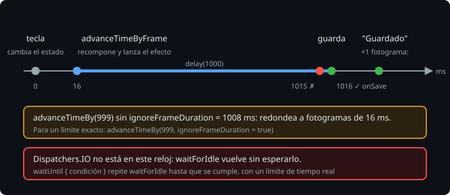

# Sincronización: cuándo está lista la pantalla

> Un test de UI pregunta por la pantalla en un momento concreto. Si pregunta antes de que la pantalla haya llegado a donde iba, falla sin que haya un error en la app, o pasa porque la pantalla aún no había llegado a hacer lo malo. Compose espera solo a una parte del trabajo: la suya. Esta teoría explica qué espera y qué no, el reloj de Compose en los tests, y qué hacer con lo que viene de otro hilo, como las consultas de Room en la Bitácora.

## 🎯 Objetivos

- Saber qué espera `waitForIdle` y qué no
- Parar y mover el reloj de Compose con `mainClock`
- Saber cuándo empieza un `LaunchedEffect` con el reloj parado
- Esperar con `waitUntil` lo que llega de otro hilo



## 1. Qué espera Compose

Cada finder y cada acción llaman antes a `waitForIdle()`. «Idle» quiere decir que Compose no tiene nada pendiente: ninguna recomposición, ningún fotograma y ninguna animación en marcha. Con el reloj en marcha (`autoAdvance = true`, por defecto), `waitForIdle` además adelanta el reloj de Compose hasta que las animaciones acaban, sin esperarlas en tiempo real (semana 25).

Lo que no es de Compose, Compose no lo espera.

> 🔬 Medido en el ejercicio 01 (Robolectric 4.17, Compose BOM 2026.09.00):
>
> | Lo pendiente | Después de `waitForIdle()` |
> | --- | --- |
> | Un `delay(1000)` en un `LaunchedEffect` | No ha terminado: el reloj de Compose está en 288 ms y no se ha guardado nada |
> | Un `withContext(Dispatchers.IO) { Thread.sleep(300) }` | Vuelve en 1 ms real, sin la lista |

En los dos casos, el test que pregunta justo después falla. No es un fallo de la app: el test ha preguntado antes de tiempo.

## 2. Esperar una condición: `waitUntil`

```kotlin
rule.waitUntil(timeoutMillis = 3_000) { saves.isNotEmpty() }
rule.waitUntil(timeoutMillis = 2_000) { rule.onAllNodesWithText("Parcela 1").fetchSemanticsNodes().isNotEmpty() }
```

`waitUntil` repite `waitForIdle` y la condición hasta que se cumple, o falla al pasar `timeoutMillis` de **tiempo real** (`ComposeTimeoutException`).

> 🔬 Medido: con el `delay(1000)` del guardado, `waitUntil` volvió en 642 ms reales, con el reloj de Compose en 1296 ms. Mientras espera, el reloj de Compose avanza más deprisa que el real, así que un `delay` dentro de Compose no cuesta su tiempo entero. Un `Thread.sleep(300)` en `IO` sí cuesta sus 300 ms: está fuera del reloj.

Hay variantes para no escribir el `fetchSemanticsNodes`: `waitUntilExactlyOneExists(hasText("Parcela 1"))`, `waitUntilAtLeastOneExists`, `waitUntilDoesNotExist` y `waitUntilNodeCount`. Son experimentales (`@OptIn(ExperimentalTestApi::class)`).

La condición tiene que ser lo que el test necesita, no un tiempo. Un `Thread.sleep(500)` en un test pasa en tu máquina, falla en la CI cuando va lenta y, cuando pasa, hace la suite más lenta de lo que hace falta.

## 3. El reloj parado

Para ver un estado intermedio («Guardando…» antes del segundo), hay que parar el reloj:

```kotlin
rule.mainClock.autoAdvance = false
rule.setContent { NoteField(onSave = { saves += it }) }
rule.onNodeWithText("Nota").performTextInput("riego")
rule.mainClock.advanceTimeByFrame()                               // la recomposición y el LaunchedEffect
rule.mainClock.advanceTimeBy(SAVE_AFTER - 1, ignoreFrameDuration = true)
// aquí no se ha guardado
rule.mainClock.advanceTimeBy(1, ignoreFrameDuration = true)
// aquí sí
```

Con el reloj parado, nada pasa hasta que el test lo mueve. Eso incluye recomponer.

> 🔬 Medido, con `delay(1000)` en un `LaunchedEffect(text)`:
>
> | Después de escribir | Reloj | ¿Guardado? |
> | --- | --- | --- |
> | `waitForIdle()` | 0 | No: no recompone, el efecto no ha empezado |
> | `waitForIdle()` y `advanceTimeBy(1000, ignoreFrameDuration = true)` | 1000 | No |
> | `advanceTimeByFrame()` | 16 | No: el efecto empieza en este fotograma |
> | ... y `advanceTimeBy(999, ignoreFrameDuration = true)` | 1015 | No |
> | ... y `advanceTimeBy(1, ignoreFrameDuration = true)` | 1016 | Sí |
> | `advanceTimeBy(999)` (sin `ignoreFrameDuration`) | 1008 | No |
> | ... y `advanceTimeBy(16)` | 1024 | Sí |

Tres cosas salen de la tabla:

1. **Una tecla no lanza el efecto.** Cambia el estado. La recomposición, y con ella el `LaunchedEffect` nuevo, llega en el fotograma siguiente, a los 16 ms.
2. **`advanceTimeBy` redondea a fotogramas.** Sin `ignoreFrameDuration = true`, 999 ms se convierten en 1008 (63 fotogramas de 16 ms). Para comprobar un límite exacto («a los 999 no, a los 1000 sí»), hace falta `ignoreFrameDuration = true`.
3. **Lo que cambia el efecto también necesita un fotograma.** Después de `saves == ["riego"]`, el texto «Guardado» no está en la pantalla hasta el siguiente `advanceTimeByFrame()`.

`mainClock.currentTime` dice en qué milisegundo está el reloj: úsalo cuando un test con el reloj parado no hace lo que esperas.

## 4. Lo que llega de otro hilo

En la Bitácora, la lista llega de Room, que consulta en `Dispatchers.IO` (semana 30). Ni `waitForIdle` ni el reloj de Compose saben nada de ese hilo. La semana 30 lo resolvió con `launch()`:

```kotlin
fun ComposeTestRule.waitForTheList(activity: MainActivity) {
    val viewModel = ViewModelProvider(activity)[BitacoraViewModel::class.java]
    waitUntil(5_000) {
        shadowOf(Looper.getMainLooper()).idle()     // lo que Room ha dejado para el hilo principal
        viewModel.state.value.loaded
    }
}
```

Hay dos formas de que Compose sepa de un trabajo que no es suyo:

| Forma | Cómo | En la Bitácora |
| --- | --- | --- |
| Esperar una condición | `waitUntil { ... }` sobre lo que el test necesita | `launch()`, `thePlotsArrive` |
| Registrar un `IdlingResource` | `rule.registerIdlingResource(resource)`, con `isIdleNow` en `false` mientras hay trabajo | No se usa: obliga a tocar el código de la app para contar el trabajo pendiente |
| Quitar el otro hilo | Inyectar el dispatcher y pasar uno de test (semana 34) | El ViewModel con `setMain`; el `MockEngine` de la red |

La tercera es la mejor cuando se puede: el test deja de depender del tiempo real. En la Bitácora, la base de datos fija `Dispatchers.IO` para sus consultas (semana 30) y los tests de pantalla no lo cambian, y por eso `launch()` espera.

## ⚠️ Errores comunes

| Error | Qué pasa | Solución |
| --- | --- | --- |
| Comprobar justo después de algo que corre en `IO` | Falla a veces: depende de lo rápido que vaya el otro hilo | `waitUntil` con la condición |
| `Thread.sleep` en un test de UI | Lento siempre; falla cuando la máquina va lenta | `waitUntil`, o el reloj parado |
| Reloj parado y `waitForIdle()` para «dejar que recomponga» | No recompone: el reloj no se mueve | `advanceTimeByFrame()` |
| `advanceTimeBy(999)` para «justo antes del segundo» | Son 1008 ms: ya ha pasado | `ignoreFrameDuration = true` |
| Olvidar el fotograma que lanza el efecto | El efecto termina 16 ms más tarde de lo que el test cuenta | `advanceTimeByFrame()` después de la acción |
| `waitUntil` sin `timeoutMillis` | Espera 1 s por defecto; en la CI puede no bastar | Un tiempo explícito, holgado: si la condición se cumple antes, no se espera |

## 📝 Resumen

- `waitForIdle` espera a Compose: recomposiciones, fotogramas y animaciones. No espera a un `delay` en un efecto ni a otro hilo.
- `waitUntil` espera una condición. Avanza el reloj de Compose más deprisa que el real, y su límite es de tiempo real.
- Con `autoAdvance = false`, nada pasa hasta que el test mueve el reloj, ni siquiera la recomposición.
- Un efecto empieza en el fotograma siguiente a la acción. `advanceTimeBy` redondea a fotogramas salvo con `ignoreFrameDuration = true`.
- Lo que viene de otro hilo se espera con `waitUntil`, o se elimina inyectando el dispatcher.

## 🔗 Recursos

- [Sincronizar los tests de Compose](https://developer.android.com/develop/ui/compose/testing/synchronization)
- [`MainTestClock`](https://developer.android.com/reference/kotlin/androidx/compose/ui/test/MainTestClock)
- [Idling resources de Espresso](https://developer.android.com/training/testing/espresso/idling-resource)
