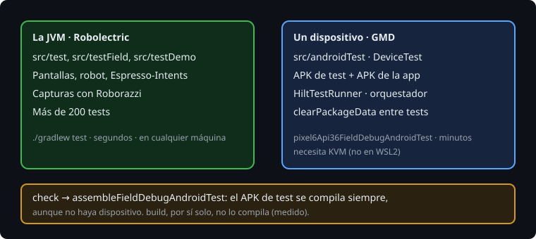

# Tests instrumentados y Gradle Managed Devices

> Todo lo que la Bitácora ha probado hasta ahora corre en la JVM, con Robolectric. Es rápido y no necesita nada, pero no es un Android de verdad: el teclado, el pintado, los permisos del sistema y el rendimiento son los de una simulación. Los **tests instrumentados** se ejecutan en un dispositivo o un emulador, dentro de un APK de test que se instala junto a la app. Esta teoría explica cómo se montan en la Bitácora, cómo se ejecutan en un emulador que Gradle gestiona solo, y qué falta para ejecutarlos en esta máquina.

## 🎯 Objetivos

- Montar `src/androidTest` con Hilt y los fakes de `:core:data`
- Configurar el orquestador y borrar los datos entre tests
- Definir un Gradle Managed Device y saber qué tareas crea
- Decidir qué va en la JVM y qué en un dispositivo
- Hacer que `check` compile los tests instrumentados



## 1. `src/androidTest`

| | `src/test` | `src/androidTest` |
| --- | --- | --- |
| Dónde corre | La JVM de tu máquina (Robolectric para lo de Android) | Un dispositivo o emulador |
| Qué se construye | Nada que instalar | Un segundo APK, `app-field-debug-androidTest.apk`, que se instala con la app |
| Dependencias | `testImplementation` | `androidTestImplementation` |
| Procesadores (Hilt) | `kspTest` | `kspAndroidTest` |
| Tarea | `testFieldDebugUnitTest` | `connectedFieldDebugAndroidTest` (un dispositivo conectado) o la de un GMD |

El test se escribe igual que en la JVM: `createAndroidComposeRule<MainActivity>()`, finders y aserciones. Lo que cambia es dónde corre.

```kotlin
@HiltAndroidTest
@RunWith(AndroidJUnit4::class)
class DeviceTest {
    @get:Rule(order = 0)
    val hilt = HiltAndroidRule(this)

    @get:Rule(order = 1)
    val rule = createAndroidComposeRule<MainActivity>()

    @Test
    fun addingShowsTheRow() {
        rule.onNodeWithText("Descripción").performTextInput("riego")
        rule.onNodeWithText("Alta").performClick()
        rule.onNodeWithText("A-1 · Alta · riego").assertExists()
    }
}
```

En el dispositivo no hay `@Config(qualifiers = "+es")`: el idioma es el del dispositivo. Un test que busca textos en español necesita un emulador en español, o buscar por recurso (`getString(R.string.share)` con el contexto de la app).

## 2. Hilt en el dispositivo: el runner

En la JVM, `@Config(application = HiltTestApplication::class)` cambia la aplicación (semana 29). En un dispositivo la aplicación la crea el **runner** de instrumentación, y hay que darle uno que cree la de Hilt:

```kotlin
class HiltTestRunner : AndroidJUnitRunner() {
    override fun newApplication(cl: ClassLoader?, name: String?, context: Context?): Application =
        super.newApplication(cl, HiltTestApplication::class.java.name, context)
}
```

```kotlin
android {
    defaultConfig {
        testInstrumentationRunner = "dev.bitacora.HiltTestRunner"
    }
}
```

El módulo de test (`@TestInstallIn(replaces = [AppModule::class])`) va en `src/androidTest`, igual que `FakeModule` va en `src/testField`. Usa los mismos fakes, de los `testFixtures` de `:core:data` (semana 34): `androidTestImplementation(testFixtures(project(":core:data")))`.

> 🔬 Medido: `kspAndroidTest(libs.hilt.compiler)` trae guava 33.6.0-jre, la del aviso GHSA-xxph-c9ww-hj94 (semana 29). La restricción que ya tenían `ksp` y `kspTest` hace falta también en `kspAndroidTest`. Así lo encontró `--write-verification-metadata`: entraba `guava-33.6.0-jre` como componente nuevo.

## 3. El orquestador

Por defecto, todos los tests instrumentados corren en el mismo proceso, uno detrás de otro. Si uno deja datos (una observación en Room, una preferencia en DataStore), el siguiente los ve. El **orquestador** ejecuta cada test en su propio proceso, y con `clearPackageData` borra los datos de la app entre uno y otro:

```kotlin
android {
    defaultConfig {
        testInstrumentationRunnerArguments["clearPackageData"] = "true"
    }
    testOptions {
        execution = "ANDROIDX_TEST_ORCHESTRATOR"
    }
}

dependencies {
    androidTestUtil(libs.androidx.test.orchestrator)    // se instala en el dispositivo, no va en el APK de test
}
```

Cuesta tiempo (un proceso por test), y compensa: un test que depende del orden en que se ejecutan los demás falla de vez en cuando y es muy difícil de encontrar.

## 4. Gradle Managed Devices

Un **Gradle Managed Device** (GMD) es un emulador que Gradle descarga, crea, arranca, usa y apaga. Se describe en el build, como cualquier otra cosa:

```kotlin
android {
    testOptions {
        managedDevices {
            localDevices {
                create("pixel6Api36") {
                    device = "Pixel 6"
                    apiLevel = 36
                    systemImageSource = "aosp-atd"
                }
            }
        }
    }
}
```

> 🔬 Medido con AGP 9.4.1: el bloque crea, entre otras, `pixel6Api36FieldDebugAndroidTest`, `pixel6Api36DemoDebugAndroidTest`, `allDevicesFieldDebugAndroidTest`, `pixel6Api36Check`, `allDevicesCheck` y `cleanManagedDevices`.

`aosp-atd` es una imagen **ATD** (*Automated Test Device*): sin las apps que no hacen falta para un test, más ligera y más rápida de arrancar. `sdkmanager --list` enseña cuáles hay. Para la API 36 están `aosp_atd` y `google_atd` (esta con los servicios de Google, para el mapa).

Para ejecutar los tests de la Bitácora en un emulador nuevo y limpio:

```bash
./gradlew pixel6Api36FieldDebugAndroidTest
```

La primera vez descarga la imagen del sistema. Después, Gradle arranca el emulador sin ventana, instala los dos APK, ejecuta los tests y lo apaga. Al terminar, la tarea dice dónde ha dejado el informe.

> ⚠️ **No medido aquí.** Un emulador necesita aceleración por hardware: KVM en Linux, y WSL2 no la tiene por defecto (semana 15). En esta preparación, los tests instrumentados se han compilado (`assembleFieldDebugAndroidTest`) pero no ejecutado. Ejecútalos en una máquina con KVM o con un dispositivo conectado (`connectedFieldDebugAndroidTest`), y anota tus tiempos.

## 5. Que el build los compile

> 🔬 Medido: `./gradlew build -m` no compila `src/androidTest`. Solo pasa lint por sus fuentes (`lintAnalyzeFieldDebugAndroidTest`). Un `androidTest` que no compila no se ve hasta que alguien tiene un dispositivo a mano.

En la Bitácora, `check` depende del APK de test:

```kotlin
tasks.named("check") {
    dependsOn("assembleFieldDebugAndroidTest")
}
```

Compilarlo no lo ejecuta, pero un cambio en la app que rompe un test instrumentado para el build en cualquier máquina. `UiTest.checkCompilesTheInstrumentedTests` lo comprueba (28 s con TestKit).

## 6. Qué va dónde

| En la JVM (Robolectric) | En un dispositivo |
| --- | --- |
| La lógica de cada pantalla, sus estados y sus textos | Que la app arranca de verdad, con su `Application` y sus servicios |
| Lo que sale con Intents, contestado con `intending` | El teclado de verdad, el foco, el IME |
| Capturas con Roborazzi | Permisos del sistema, el diálogo incluido |
| Navegación, muerte del proceso, rotación (simuladas) | El mapa con Play Services, la cámara |
| | El rendimiento: arranque, fluidez (semana 36) |

La Bitácora tiene más de 200 tests en la JVM y uno en el dispositivo, y no es un error. Un test instrumentado cuesta un emulador y minutos. Va donde la JVM no llega, y comprueba un recorrido que valga la pena: abrir, escribir y ver la fila.

## ⚠️ Errores comunes

| Error | Qué pasa | Solución |
| --- | --- | --- |
| `@HiltAndroidTest` sin el runner de Hilt | En el dispositivo, la app es `BitacoraApp` y no `HiltTestApplication`: el módulo de test no se aplica | `testInstrumentationRunner` con un runner que cree `HiltTestApplication` |
| `kspTest` pero no `kspAndroidTest` | 🔬 `assembleFieldDebugAndroidTest` compila sin error: falta lo que Hilt genera para `DeviceTest`, y el fallo solo puede aparecer al ejecutarlo en el dispositivo (no medido aquí) | `kspAndroidTest(libs.hilt.compiler)` |
| Los fakes con `testImplementation` solo | `src/androidTest` no los ve | `androidTestImplementation(testFixtures(...))` |
| `androidTestImplementation` para el orquestador | No se instala aparte | `androidTestUtil` |
| Confiar en que `build` compila los instrumentados | Un `androidTest` roto pasa desapercibido | `check` dependiendo de `assemble...AndroidTest` |
| Un GMD en WSL2 sin KVM | El emulador no arranca | Una máquina con KVM, la CI, o un dispositivo con `connected...` |

## 📝 Resumen

- `src/androidTest` corre en un dispositivo, dentro de un APK de test que se instala con la app.
- Hilt necesita un runner que cree `HiltTestApplication`. Los fakes llegan de los `testFixtures`.
- El orquestador aísla cada test en su proceso, y `clearPackageData` borra los datos entre uno y otro.
- Un GMD es un emulador descrito en el build: `pixel6Api36FieldDebugAndroidTest` lo crea, lo usa y lo apaga. Necesita KVM.
- `build` no compila `androidTest`: que `check` dependa del APK de test.
- En la JVM, casi todo. En el dispositivo, lo que solo existe en un Android de verdad.

## 🔗 Recursos

- [Tests instrumentados](https://developer.android.com/training/testing/instrumented-tests)
- [Gradle Managed Devices](https://developer.android.com/studio/test/gradle-managed-devices)
- [AndroidX Test Orchestrator](https://developer.android.com/training/testing/instrumented-tests/androidx-test-libraries/runner#use-android)
- [Probar con Hilt](https://developer.android.com/training/dependency-injection/hilt-testing#instrumented-tests)
