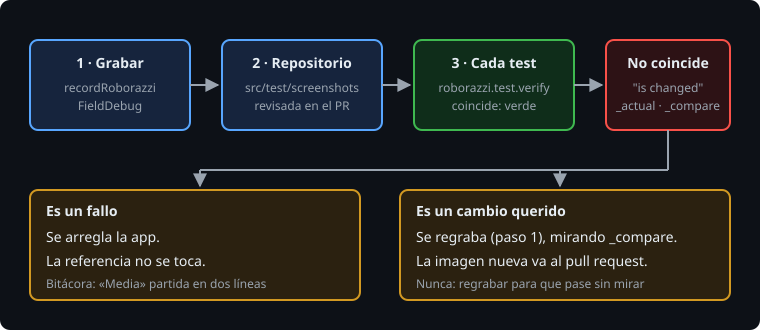
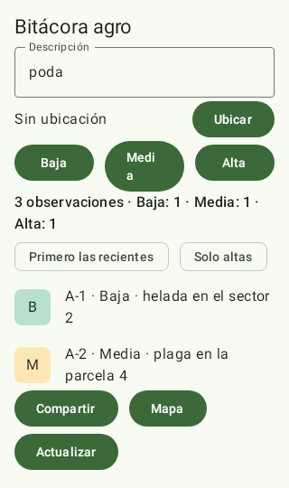

# Capturas con Roborazzi

> Un test con aserciones comprueba lo que alguien pensó comprobar: que la fila dice «A-1 · Alta · riego», que el botón está activo. No ve que el texto se sale del botón, que el color de noche no se lee o que un relleno empuja la lista fuera de la pantalla. Un **test de captura** guarda una imagen de referencia y, en cada ejecución, compara la pantalla con ella píxel a píxel. **Roborazzi** lo hace en la JVM, sobre Robolectric. En la Bitácora, la primera captura encontró un fallo que estaba en la pantalla desde la semana 22.

## 🎯 Objetivos

- Grabar, verificar y comparar capturas con Roborazzi
- Hacer que `./gradlew test` compare siempre
- Escribir capturas deterministas: tema, color dinámico, tamaño de letra y modo noche
- Leer una diferencia y decidir si es un fallo o un cambio querido



## 1. El plugin y la primera captura

```toml
[versions]
roborazzi = "1.79.0"

[libraries]
roborazzi = { module = "io.github.takahirom.roborazzi:roborazzi", version.ref = "roborazzi" }
roborazzi-compose = { module = "io.github.takahirom.roborazzi:roborazzi-compose", version.ref = "roborazzi" }

[plugins]
roborazzi = { id = "io.github.takahirom.roborazzi", version.ref = "roborazzi" }
```

```kotlin
@RunWith(AndroidJUnit4::class)
@GraphicsMode(GraphicsMode.Mode.NATIVE)           // Robolectric pinta de verdad (semana 23)
@Config(qualifiers = "+es")
class ScreenshotTest {
    @get:Rule
    val rule = createComposeRule()

    @Test
    fun theLevels() {
        rule.setContent {
            BitacoraTheme(dynamicColor = false) {
                Surface { Column { observations.forEach { ObservationRow(it, {}) } } }
            }
        }
        rule.onRoot().captureRoboImage()
    }
}
```

`captureRoboImage()` funciona sobre un nodo de Compose (`onRoot()`, `onNodeWithTag(...)`) y sobre una vista de Espresso (`onView(isRoot())`, ejercicio 02). El nombre del archivo sale de la clase y el método: `dev.bitacora.ScreenshotTest.theLevels.png`.

> 🔬 Medido con Roborazzi 1.79.0, AGP 9.4.1 y Robolectric 4.17: funciona sin más configuración. Con la JVM ya arrancada, cada captura tarda de 0,08 a 0,45 s (`theLevelsAtNight` 0,08 s, `theScreen` 0,45 s).

## 2. Grabar, verificar, comparar

El plugin añade tareas por variante:

| Tarea | Qué hace `captureRoboImage()` |
| --- | --- |
| `recordRoborazziFieldDebug` | Guarda la captura como referencia (la sobrescribe si ya está) |
| `verifyRoborazziFieldDebug` | Compara con la referencia y **falla** si cambia o no está |
| `compareRoborazziFieldDebug` | Compara y deja las imágenes de la diferencia, **sin fallar** |
| `testFieldDebugUnitTest` (sin más) | Nada |

> 🔬 Medido: con `./gradlew test` y sin nada más, `captureRoboImage()` no hace nada: no graba, no compara y no deja ningún archivo. Un test de captura que no falla nunca no sirve para nada.

Por eso la Bitácora lo pide en `gradle.properties`:

```properties
# ./gradlew test compara las capturas con las de referencia (app/src/test/screenshots).
roborazzi.test.verify=true
```

> 🔬 Medido: con la propiedad, `testFieldDebugUnitTest` verifica. `recordRoborazziFieldDebug` sigue grabando: la tarea manda sobre la propiedad.

Y las referencias van con el código, no en `build/`:

```kotlin
roborazzi {
    outputDir.set(layout.projectDirectory.dir("src/test/screenshots"))
}
```

## 3. Cuando no coincide

> 🔬 Medido, con la fila de nivel bajo en lugar de alto:
>
> ```
> java.lang.AssertionError: Roborazzi: .../app/src/test/screenshots/dev.bitacora.ScreenshotTest.aRow.png is changed.
> See the compare image at .../app/build/outputs/roborazzi/dev.bitacora.ScreenshotTest.aRow_compare.png
> ```
>
> Y con un test nuevo, sin referencia:
>
> ```
> Roborazzi: The original file(.../dev.bitacora.ScreenshotTest.aRowAtNight.png) was not found.
> ```

En `build/outputs/roborazzi/` quedan dos imágenes: `_actual`, la de ahora, y `_compare`, con la referencia, la diferencia en rojo y la nueva una al lado de otra. Ante una diferencia hay dos respuestas:

1. **Es un fallo.** Se arregla la app, y la captura vuelve a coincidir sin tocar la referencia.
2. **Es un cambio querido** (un color nuevo, otro texto). Se regraba con `recordRoborazziFieldDebug`, y la imagen nueva entra en el pull request. Quien revisa ve la imagen de antes y la de después en el diff, y decide.

Nunca se regraba para que pase sin mirar `_compare`. Eso convierte el test en una foto de lo que haya, sea lo que sea.

## 4. Capturas que no cambian solas

Una captura falla con cualquier diferencia de píxel. Todo lo que pueda cambiar sin que cambie la app tiene que quedar fijo:

| Lo que cambia solo | En la Bitácora |
| --- | --- |
| El color dinámico, que sale del fondo de pantalla (semana 23) | `BitacoraTheme(dynamicColor = false)`: los colores de la Bitácora, no los del móvil |
| El color del contenido sin `Surface` | 🔬 Medido: sin `Surface`, la captura de noche sale con el fondo negro y la letra de las insignias en negro sobre el color oscuro del nivel. Con `Surface`, fondo y texto son los del tema |
| El idioma | `@Config(qualifiers = "+es")` |
| El tamaño de pantalla | El de Robolectric por defecto (320 × 470 dp, densidad 1), o uno fijo con `qualifiers` |
| Animaciones a medias | Capturar con la pantalla quieta. Con el reloj parado, en el fotograma que interese (teoría 03) |
| La hora, un dato aleatorio | Inyectarlos en el estado. `ScreenshotTest` pinta `BitacoraScreen` con un estado hecho a mano |

Y lo que sí debe variar, se captura a propósito:

```kotlin
@Test
@Config(qualifiers = "+night")
fun theLevelsAtNight() = levels()

@Test
@Config(fontScale = 1.5f)
fun theLevelsWithLargeText() = levels()
```

> 🔬 Medido: los dos sabores de la Bitácora (`field` y `demo`) ejecutan `ScreenshotTest` (está en `src/test`) y verifican contra las mismas referencias, porque pintan lo mismo. Una pantalla que cambie entre sabores necesitaría sus capturas en `src/testField` o `src/testDemo`.

Las referencias de este proyecto se grabaron en Linux. Las fuentes y el pintado de Robolectric pueden no ser idénticos en otro sistema (no medido aquí). La práctica habitual es grabar y verificar en el mismo sitio: la CI, o un contenedor igual a ella.

## 5. Lo que encontró la primera captura

> 🔬 Medido en el proyecto. La primera captura de `BitacoraScreen`, a 320 dp de ancho:
>
> 
>
> «Media» no cabe en su botón y se parte en «Medi» y «a». Los tres botones de nivel se reparten el ancho con `weight(1f)`: (288 − 2 × 12) / 3 = 88 dp por botón, menos 24 dp de relleno por lado que pone `Button` por defecto, deja 40 dp para el texto.

Ningún test lo veía. `theLevelsShareTheWidth` (semana 22) comprueba que los tres botones miden lo mismo, y lo miden. `LanguagesTest` comprueba los textos de los botones, y son los que tocan. La captura enseña lo que nadie había pensado preguntar. Se arregló con menos relleno (`contentPadding = PaddingValues(horizontal = 8.dp)`), y la captura nueva entró en el mismo cambio.

## 6. Otras herramientas

| Herramienta | Cómo pinta | Diferencia con Roborazzi |
| --- | --- | --- |
| Paparazzi (Cash App) | `layoutlib`, el motor de las vistas previas de Android Studio, sin Robolectric | No ejecuta la app: no hay actividad, Hilt ni Espresso. Solo pinta composables y vistas |
| Compose Preview Screenshot Testing (Google) | Las `@Preview` del código, con `layoutlib` | Las capturas son las vistas previas; no hay test que escribir |
| Capturas en un dispositivo | El pintado real | Lo más fiel, y lo más lento y frágil (el dispositivo tiene que ser siempre el mismo) |

La Bitácora usa Roborazzi porque ya tiene Robolectric: las capturas se escriben como los demás tests y pueden abrir la app entera. Esta semana no se han medido Paparazzi ni las vistas previas.

## ⚠️ Errores comunes

| Error | Qué pasa | Solución |
| --- | --- | --- |
| Sin `roborazzi.test.verify` ni la tarea `verify` | `./gradlew test` pasa siempre | `roborazzi.test.verify=true` en `gradle.properties` |
| Las referencias en `build/` | `clean` las borra y nadie las revisa | `outputDir` en `src/test/screenshots`, en el repositorio |
| Sin `@GraphicsMode(NATIVE)` | 🔬 Medido en el ejercicio 02: Roborazzi no guarda la pantalla, sino un volcado de la jerarquía (cajas de colores con las propiedades de cada vista) | `NATIVE` en la clase |
| Color dinámico en la captura | Depende del fondo de pantalla del emulador | `dynamicColor = false` |
| Regrabar sin mirar `_compare` | El test acepta cualquier cosa | Mirar la diferencia; regrabar solo un cambio querido, y enseñarlo en el pull request |
| Capturar una pieza sin `Surface` | El color del contenido es el de por defecto (negro) | Envolver en `Surface`, como hace la pantalla |
| Subir de versión y ver todas las capturas cambiar | Roborazzi 1.78.0 cambió cómo escribe los PNG: los mismos píxeles en otros bytes (lo dicen sus notas de versión) | Regrabar una vez, en un cambio aparte, solo con la subida |

## 📝 Resumen

- `captureRoboImage()` graba, verifica o compara según la tarea. Con `test` a secas no hace nada.
- `roborazzi.test.verify=true` hace que cada `./gradlew test` compare. `record...` regraba a propósito.
- Las referencias van en el repositorio, y sus cambios se revisan en el pull request como el código.
- Una captura útil es determinista: sin color dinámico, con `Surface`, con idioma, tamaño y estado fijos.
- Captura a propósito lo que sí varía: noche, letra grande, otro tamaño de pantalla.
- Una captura ve lo que ninguna aserción preguntó: en la Bitácora, un botón con el texto partido.

## 🔗 Recursos

- [Roborazzi](https://github.com/takahirom/roborazzi)
- [Tests de capturas en Android](https://developer.android.com/training/testing/ui-tests/screenshot)
- [Notas de la versión 1.78.0 de Roborazzi](https://github.com/takahirom/roborazzi/releases/tag/1.78.0)
