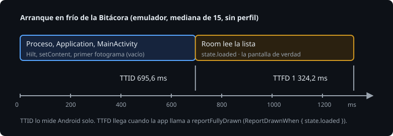

# Medir el rendimiento

> Hasta ahora, la Bitácora se ha probado para saber si hace lo que debe. Esta semana se mide para saber cuánto tarda: en arrancar, en enseñar la lista, en pintar cada fotograma al recorrerla. Antes de cambiar nada hay que saber qué se mide, dónde y con qué números se compara. Esta teoría da el vocabulario y las cuentas; las siguientes, las herramientas.

## 🎯 Objetivos

- Distinguir el arranque en frío, tibio y caliente
- Explicar qué miden `timeToInitialDisplayMs` y `timeToFullDisplayMs`
- Saber qué es un fotograma tarde (jank) y cómo se cuenta
- Leer una serie de medidas con su mediana, su coeficiente de variación y sus percentiles
- Saber por qué se mide una release en un dispositivo, y qué queda para Microbenchmark



## 1. Tres arranques

| Arranque | Qué hay antes | Qué tiene que hacer Android |
| --- | --- | --- |
| **Frío** | Nada: el proceso no existe | Crear el proceso, cargar las clases, crear `Application` y la actividad, pintar |
| **Tibio** | El proceso existe, la actividad no | Crear la actividad y pintar |
| **Caliente** | La actividad está en segundo plano | Traerla delante |

El frío es el más lento y el que más se nota: es el de la primera vez del día, o después de que Android haya matado la app para liberar memoria. Es el que mide la Bitácora.

## 2. Dos momentos del arranque

- **`timeToInitialDisplayMs` (TTID)**: desde que se pide la actividad hasta su primer fotograma. Lo mide Android solo.
- **`timeToFullDisplayMs` (TTFD)**: hasta que la app dice que está lista para usarse, con `reportFullyDrawn()`. Android no lo sabe: lo dice la app (teoría 05).

En la Bitácora, la diferencia es grande. El primer fotograma sale vacío, porque `MainActivity` no pinta nada hasta que Room ha leído la lista (`if (!state.loaded) return@setContent`, semana 30). La pantalla que la persona puede usar llega después.

> 🔬 Medido en un emulador Pixel 6 con API 36, 15 arranques en frío sin perfil: TTID, mediana de 695,6 ms; TTFD, 1 324,2 ms. Más de la mitad del arranque es esperar a la lista, y TTID no lo ve.

## 3. Los fotogramas

A 60 Hz, cada fotograma tiene 16,7 ms. Si la app tarda más, el fotograma sale tarde y la persona ve un salto: **jank**. Macrobenchmark lo cuenta con `FrameTimingMetric`:

- **`frameDurationCpuMs`**: lo que tardó la app en preparar el fotograma (hilo principal y de render).
- **`frameOverrunMs`**: cuánto se pasó del plazo. Negativo, llegó a tiempo; positivo, tarde.
- **`frameCount`**: cuántos fotogramas hubo.

Un fotograma es una medida, y en un recorrido de la lista hay decenas. No se miran uno a uno: se miran sus percentiles.

## 4. Las cuentas

Una medida sola no dice nada: el móvil hace otras cosas a la vez. Se repite y se resume.

| Cuenta | Qué es | Para qué |
| --- | --- | --- |
| **Mediana** | El valor del medio de los ordenados | El valor típico. Un arranque raro mueve la media, casi no la mediana |
| **Coeficiente de variación (CV)** | Desviación típica entre media | Cuánto ruido hay. 0,10 es un 10 % |
| **Percentil P90** | El valor por debajo del cual queda el 90 % | Lo que ve la persona en los peores momentos |

```
runs (ms):  612  629  652  656  673  699  700  724  761  766
mediana:    (673 + 699) / 2 = 686
```

> 🔬 Medido con el JSON de Macrobenchmark 1.5.0 (ejercicio 01): la mediana es la de siempre, con la media de los dos del medio si hay un número par. El CV usa la desviación típica **muestral**, dividida entre n − 1. Los percentiles de los fotogramas se calculan con los de todas las iteraciones juntos, interpolando entre los dos vecinos.

Dos medidas solo se comparan si el ruido es menor que la diferencia. Con un CV del 12 %, una mejora del 6 % no se distingue del azar (teoría 06).

## 5. Release, y en un dispositivo

| Si mides... | Lo que pasa |
| --- | --- |
| La variante debug | `debuggable="true"` apaga optimizaciones de ART. Mides algo que nadie usa |
| En la JVM con Robolectric | No hay ART, ni GPU, ni el pintado de verdad. Robolectric no sirve para tiempos |
| En un emulador | Funciona, pero la CPU es la de tu máquina, compartida, y la GPU es software. Los números no son los de un móvil |
| Una release en un móvil real | Lo que ve la persona |

Macrobenchmark no deja medir en un emulador sin que se lo digas: falla con `ERRORS (not suppressed): EMULATOR` (teoría 02). Esta semana se mide en uno igualmente, para aprender a montar y leer las medidas. Los números de la semana son de un emulador y se presentan como tales.

## 6. Microbenchmark, solo para saberlo

Macrobenchmark mide la app entera desde fuera: arranques, recorridos, gestos. **Microbenchmark** (`androidx.benchmark:benchmark-junit4`, `BenchmarkRule`) mide una función dentro del proceso, miles de veces: un parser, un algoritmo, una consulta.

```kotlin
@get:Rule val rule = BenchmarkRule()

@Test
fun summary() = rule.measureRepeated {
    resources.summary(observations)
}
```

Va en su propio módulo de biblioteca, también en un dispositivo. La Bitácora no tiene ninguna función tan caliente que lo justifique, y esta semana no lo usa.

## ⚠️ Errores comunes

| Error | Qué pasa | Arreglo |
| --- | --- | --- |
| Mirar solo TTID | En la Bitácora, el primer fotograma es una pantalla vacía | `reportFullyDrawn` y TTFD (teoría 05) |
| Comparar medias | Un arranque de 1,9 s entre diez de 0,7 s sube la media un 17 % | La mediana |
| Una sola medida antes y otra después | El ruido es del 6 al 12 % | Iteraciones, y mirar el CV |
| Medir la debug | ART no optimiza igual una app depurable | La variante `benchmarkRelease` (teoría 02) |
| Creer al emulador | CPU compartida y GPU por software | Un móvil real para decidir |

## 📝 Resumen

- El frío es el arranque que importa. TTID es el primer fotograma y TTFD, cuando la app dice que está lista.
- El jank se mide por fotograma, con sus percentiles.
- Mediana para el valor típico, CV para el ruido, P90 y P99 para los peores momentos.
- Se mide una release en un dispositivo. El emulador sirve para montar y aprender, no para decidir.
- Microbenchmark es para funciones; Macrobenchmark, para la app.

## 🔗 Recursos

- [Tiempo de inicio de la app](https://developer.android.com/topic/performance/vitals/launch-time)
- [Jank y fotogramas lentos](https://developer.android.com/topic/performance/vitals/render)
- [Microbenchmark](https://developer.android.com/topic/performance/benchmarking/microbenchmark-overview)
