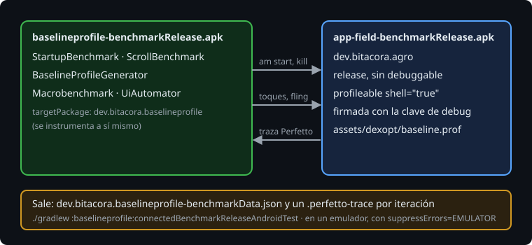

# Macrobenchmark

> Macrobenchmark mide la app como la usaría una persona: la arranca, toca, desliza, y mientras tanto graba una traza del sistema. De la traza saca los tiempos. Vive en un módulo propio, con un APK que no lleva la app dentro y la maneja desde fuera. Esta teoría monta ese módulo en la Bitácora y escribe sus dos benchmarks: el arranque y el recorrido de la lista.

## 🎯 Objetivos

- Crear un módulo `com.android.test` que apunte a la app
- Saber qué es la variante `benchmarkRelease` y por qué se mide esa
- Escribir un benchmark con `MacrobenchmarkRule` y `measureRepeated`
- Manejar la app con UiAutomator, buscando por `resource-id`
- Ejecutarlo y leer lo que deja: el JSON y las trazas



## 1. El módulo

```kotlin
// baselineprofile/build.gradle.kts
plugins {
    alias(libs.plugins.android.test)        // com.android.test, la misma versión que AGP
    alias(libs.plugins.baselineprofile)     // androidx.baselineprofile 1.5.0
}

android {
    namespace = "dev.bitacora.baselineprofile"
    compileSdk = 37
    defaultConfig {
        minSdk = 28
        targetSdk = 36
        testInstrumentationRunner = "androidx.test.runner.AndroidJUnitRunner"
        missingDimensionStrategy("environment", "field")
    }
    targetProjectPath = ":app"
}

dependencies {
    implementation(libs.androidx.test.junit)
    implementation(libs.uiautomator)
    implementation(libs.benchmark.macro.junit4)
}
```

- `com.android.test` es un módulo que solo tiene tests. Su código va en `src/main`, no en `src/androidTest`.
- `targetProjectPath` dice qué app se mide. Para ejecutar, Gradle empaqueta antes la app.
- La app tiene el flavor `environment` y el módulo no: `missingDimensionStrategy` elige `field`.
- El mismo módulo sirve para los benchmarks y para generar el Baseline Profile (teoría 04). Por eso se llama `baselineprofile`.

> 🔬 Medido: el APK del módulo se instrumenta a sí mismo. Su manifiesto dice `android:targetPackage="dev.bitacora.baselineprofile"`, no el de la app. No vive en el proceso de la app: la arranca, la mata y la toca desde la shell del dispositivo, como `adb`.

## 2. La variante que se mide

El plugin `androidx.baselineprofile`, aplicado en la app y en el módulo, añade dos tipos de build copiados de `release`:

| Tipo | Para qué |
| --- | --- |
| `benchmarkRelease` | Medir: como `release`, pero firmada con la clave de debug y trazable desde la shell |
| `nonMinifiedRelease` | Generar el perfil (teoría 04): sin R8, para que los nombres de las clases sean los del código |

> 🔬 Medido en el manifiesto de `app-field-benchmarkRelease.apk`: `<profileable android:shell="true" />`, sin `debuggable`, firmado por `CN=Android Debug`. Y en la Bitácora, `./gradlew build` ensambla ya `:baselineprofile:assembleBenchmarkRelease` y `:app:assembleFieldBenchmarkRelease`: un benchmark que no compila para el build.

La demo no se publica, ni se mide. Con el plugin, el filtro de la semana 15 ya no basta: también hay `demoBenchmarkRelease`. Se apagan todas las de demo que no sean debug:

```kotlin
androidComponents {
    beforeVariants(selector().withFlavor("environment" to "demo")) { it.enable = it.buildType == "debug" }
}
```

> 🔬 El plugin avisa de cada variante apagada al configurar: ``Variant `demoNonMinifiedRelease` is disabled. If this is not intentional...``. Es intencionado: `baselineProfile { warnings { disabledVariants = false } }` en la app.

## 3. El benchmark de arranque

```kotlin
@RunWith(AndroidJUnit4::class)
class StartupBenchmark {
    @get:Rule
    val rule = MacrobenchmarkRule()

    @Test
    fun withoutProfile() = rule.measureRepeated(
        packageName = "dev.bitacora.agro",
        metrics = listOf(StartupTimingMetric()),
        compilationMode = CompilationMode.None(),
        startupMode = StartupMode.COLD,
        iterations = 15,
        setupBlock = { pressHome() },
    ) {
        startActivityAndWait()
    }
}
```

| Parámetro | Qué hace |
| --- | --- |
| `packageName` | La app que se mide: la de field, sin sufijo |
| `metrics` | Qué se saca de la traza. `StartupTimingMetric` da TTID y TTFD |
| `compilationMode` | Cómo se compila la app antes de medir (teoría 06) |
| `startupMode` | `COLD` mata el proceso antes de cada iteración |
| `setupBlock` | Lo que se hace antes de cada iteración, sin medir |
| El bloque final | Lo que se mide. `startActivityAndWait()` abre la actividad principal y espera al primer fotograma |

## 4. El de la lista, y UiAutomator

En el bloque medido no hay Compose ni finders: el benchmark está en otro proceso. Ve la pantalla como la ve la accesibilidad, con **UiAutomator** (`device`, un `UiDevice`).

```kotlin
fun MacrobenchmarkScope.scrollTheList() {
    val list = device.findObject(By.res("observations"))
    list.setGestureMargin(device.displayWidth / 5)
    list.fling(Direction.DOWN)
    device.waitForIdle()
    list.fling(Direction.UP)
}
```

`By.res("observations")` encuentra la lista por el `testTag` de la semana 35, que llega como `resource-id` gracias a `testTagsAsResourceId`. Sin él, la lista no tendría nada por lo que buscarla.

```kotlin
@Test
fun withoutProfile() = rule.measureRepeated(
    packageName = PACKAGE,
    metrics = listOf(FrameTimingMetric()),
    compilationMode = CompilationMode.None(),
    iterations = 5,
    setupBlock = {
        pressHome()
        startActivityAndWait()
        fill(40)
    },
) {
    scrollTheList()
}
```

`fill(40)` añade observaciones con UiAutomator hasta que el resumen dice «40 observaciones». Los datos de la app se quedan de una iteración a otra.

> 🔬 Tres cosas medidas al escribirlo:
> - Con `startupMode = StartupMode.COLD`, el bloque medido falla con `NullPointerException ... UiObject2.setGestureMargin(int) on a null object reference`. COLD mata la app **al terminar `setupBlock`**: el bloque empieza sin app. En el log: `No processes for name dev.bitacora.agro, skipping kill`. Para un recorrido, sin `startupMode`.
> - Con la lista vacía, `By.res("observations")` no encuentra nada: un `LazyColumn` sin filas no aparece en el árbol de UiAutomator. Con una fila, sí.
> - El botón «Alta» apagado es la `View` que se pulsa (`clickable="true" enabled="false"`); su texto sigue `enabled="true"`. Para esperar a que se encienda: `By.clickable(true).enabled(true).hasChild(By.text(high))`.

Los textos, con un patrón para los dos idiomas (`Pattern.compile("Alta|High")`): el benchmark corre en el idioma del dispositivo.

## 5. Ejecutar

| Tarea | Qué hace |
| --- | --- |
| `./gradlew :baselineprofile:connectedBenchmarkReleaseAndroidTest` | Los benchmarks en el dispositivo conectado |
| `-Pandroid.testInstrumentationRunnerArguments.class=dev.bitacora.baselineprofile.ScrollBenchmark` | Solo una clase |
| `-Pandroid.testInstrumentationRunnerArguments.androidx.benchmark.suppressErrors=EMULATOR` | Dejar que mida en un emulador |

> 🔬 En un emulador, sin el último, los dos benchmarks fallan: `java.lang.AssertionError: ERRORS (not suppressed): EMULATOR ... Benchmark is running on an emulator, which is not representative of real user devices`. Se pasa en la línea de comandos, no en el build: así no se queda puesto para un móvil real.

Lo que deja, en `baselineprofile/build/outputs/connected_android_test_additional_output/benchmarkRelease/connected/<dispositivo>/`:

- `dev.bitacora.baselineprofile-benchmarkData.json`: todas las medidas, iteración a iteración (el ejercicio 01 lo lee);
- un `.perfetto-trace` por iteración, que se abre en [ui.perfetto.dev](https://ui.perfetto.dev) para ver qué hizo cada hilo.

> 🔬 Medido: los benchmarks de arranque (3 modos × 15 iteraciones) tardaron 3 min 34 s en el emulador; los de la lista (2 × 5), 3 min 16 s, casi todo en `fill`.

## ⚠️ Errores comunes

| Error | Qué pasa | Arreglo |
| --- | --- | --- |
| `startupMode = COLD` en un recorrido | El bloque medido empieza sin app | Sin `startupMode` |
| Buscar por texto en español | El emulador está en inglés | Un patrón con los dos, o un `resource-id` |
| `suppressErrors` en el build | Se queda también para el móvil de verdad | En la línea de comandos |
| Medir la demo | Otra app, con otros datos | Las de demo, solo debug |

## 📝 Resumen

- Un módulo `com.android.test` con `targetProjectPath`, cuyo APK maneja la app desde fuera.
- Se mide `benchmarkRelease`: release, firmada con debug, trazable desde la shell.
- `measureRepeated`: métricas, compilación, modo de arranque, preparación y el bloque medido.
- UiAutomator, por `resource-id` gracias a `testTagsAsResourceId`.
- Deja un JSON con todas las medidas y una traza por iteración.

## 🔗 Recursos

- [Escribir un Macrobenchmark](https://developer.android.com/topic/performance/benchmarking/macrobenchmark-overview)
- [Métricas de Macrobenchmark](https://developer.android.com/topic/performance/benchmarking/macrobenchmark-metrics)
- [UiAutomator](https://developer.android.com/training/testing/other-components/ui-automator)
- [Perfetto](https://perfetto.dev/docs/)
