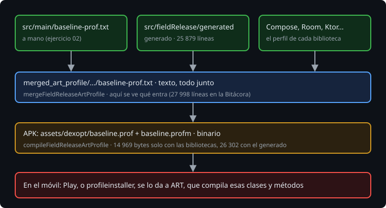

# ART y los perfiles

> Una app Android llega al móvil en bytecode (dex), no en código de máquina. ART lo convierte mientras la app corre (JIT) o antes (AOT). Compilarlo todo antes es lento y ocupa mucho, así que compila solo lo que se usa. El problema es la primera vez: recién instalada, ART no sabe qué se usa. Un **Baseline Profile** se lo dice. Esta teoría explica qué es un perfil, cómo se escribe y cómo llega al APK.

## 🎯 Objetivos

- Explicar qué hacen el intérprete, el JIT y el AOT de ART con una app
- Saber qué es un perfil y quién lo tiene en cada momento
- Leer y escribir reglas en el formato de texto (HRF)
- Seguir un perfil desde `baseline-prof.txt` hasta `assets/dexopt/baseline.prof`
- Saber qué hace `profileinstaller`



## 1. Cómo corre el código en ART

| | Cuándo | Coste |
| --- | --- | --- |
| **Intérprete** | Código que nunca se ha compilado | Lento, sin espera previa |
| **JIT** | Mientras la app corre, lo que se repite | Compila en el momento, gastando CPU, y anota lo usado en un perfil |
| **AOT** (`dex2oat`) | Con el móvil cargando y sin usar, o al instalar | Nada al correr, pero hay que saber **qué** compilar |

ART compila por adelantado lo que el perfil dice que se usa (`speed-profile`). Con el uso, el perfil crece y la app va más rápida. Las primeras veces, sin perfil, corre interpretada y con JIT: lenta justo cuando la persona la está probando.

## 2. Tres fuentes de perfil

1. **El del propio móvil**: lo que anota el JIT con el uso. Llega tarde, días después.
2. **Los de la nube**: Play junta los perfiles de quienes ya usan la app y los manda al instalar. Tardan días en formarse tras cada versión, y solo existen si la app se instala desde Play.
3. **El Baseline Profile**: va **dentro del APK**. Está desde la primera instalación de cada versión, se instale como se instale.

## 3. El formato de las reglas

Un perfil en texto (HRF, *human readable format*) es una regla por línea, con los nombres del bytecode:

```
Ldev/bitacora/BitacoraScreenKt;
HSPLdev/bitacora/MainActivity;->onCreate(Landroid/os/Bundle;)V
SPLdev/bitacora/AppModule;->database(Landroid/content/Context;)Ldev/bitacora/database/BitacoraDatabase;
```

| Parte | Qué es |
| --- | --- |
| `Ldev/bitacora/MainActivity;` | Una clase: `L`, el paquete con `/` y `;` al final. Sola, la clase se carga al arrancar |
| `->onCreate(Landroid/os/Bundle;)V` | Un método: nombre, parámetros entre paréntesis y lo que devuelve (`V`, nada) |
| `H` | *Hot*: se usa mucho, que se compile |
| `S` | *Startup*: se usa al arrancar |
| `P` | *Post-startup*: se usa después de arrancar |

Se puede usar `*` (cualquier cosa dentro de un nivel) y `**` (cualquier cosa):

```
HSPLdev/bitacora/PlotsKt;->**(**)**
Ldev/bitacora/**;
```

Las líneas con `#` son comentarios.

> 🔬 Medido en el ejercicio 02: una regla sin la `L` (`HSPdev/bitacora/Plot;->getName()Ljava/lang/String;`) para el build en `compileReleaseArtProfile` con `Error parsing baseline-prof.txt : baseline-prof.txt:3038:4 error: Illegal token 'd'`. El número de línea es el del perfil **ya fusionado** con los de las bibliotecas, no el de tu archivo: hay que buscar el texto de la regla.

Escribir a mano sirve para entender el formato o para una biblioteca pequeña. Para una app, el perfil se genera (teoría 04): 777 reglas de la Bitácora y 25 879 en total no se escriben a mano.

## 4. Del archivo al APK

```
app/src/main/baseline-prof.txt                       (a mano)
app/src/fieldRelease/generated/baselineProfiles/      (generado, teoría 04)
+ el baseline-prof.txt de cada biblioteca (Compose, Room, Ktor...)
        │  mergeFieldReleaseArtProfile
        ▼
app/build/intermediates/merged_art_profile/.../baseline-prof.txt     (texto, juntos)
        │  compileFieldReleaseArtProfile
        ▼
assets/dexopt/baseline.prof + baseline.profm                         (binario, en el APK)
```

> 🔬 Medido en la Bitácora (`app-field-release-unsigned.apk`):
> - Sin perfil propio, el APK ya tiene `assets/dexopt/baseline.prof`: 14 969 bytes, de 7 338 reglas fusionadas, todas de las bibliotecas. Compose, Room o Ktor traen el suyo.
> - Con el perfil generado: 26 302 bytes, de 27 998 reglas.
> - En el perfil fusionado, las reglas con `**` quedan tal como se escribieron; se resuelven al compilarlo.

## 5. `profileinstaller`

Play compila el perfil al instalar. Si la app se instala de otra forma (`adb install`, otra tienda, un benchmark), alguien tiene que pasárselo a ART: **`androidx.profileinstaller`**. Es una biblioteca con un `ProfileInstallReceiver` en el manifiesto, que copia el perfil del APK a donde ART lo busca.

> 🔬 Medido: en la Bitácora, `profileinstaller` 1.4.0 ya llegaba con Compose, sin declararlo (`fieldReleaseRuntimeClasspath`). Declararlo la deja en la versión del catálogo, 1.4.1. Macrobenchmark lo usa para instalar el perfil antes de medir con `CompilationMode.Partial`.

## ⚠️ Errores comunes

| Error | Qué pasa | Arreglo |
| --- | --- | --- |
| Una regla mal escrita | `Illegal token`, con la línea del archivo fusionado | Buscar el texto de la regla en tu archivo |
| Buscar el perfil como texto en el APK | Va compilado, en binario | El texto, en `merged_art_profile` |
| Pensar que sin perfil propio no hay perfil | Las bibliotecas traen el suyo | Mirar `assets/dexopt` antes de tocar nada |
| Escribir el de una app a mano | Miles de reglas que se quedan viejas | Generarlo (teoría 04) |

## 📝 Resumen

- ART interpreta, compila con JIT mientras corre y por adelantado (AOT) lo que dice el perfil.
- El Baseline Profile va en el APK: está desde la primera vez de cada versión.
- Las reglas: clases (`L...;`) y métodos (`->`) con las marcas `H`, `S` y `P`, y comodines.
- El de la app y los de las bibliotecas se juntan y se compilan en `assets/dexopt/baseline.prof`.
- `profileinstaller` se lo da a ART cuando la app no viene de Play.

## 🔗 Recursos

- [Baseline Profiles](https://developer.android.com/topic/performance/baselineprofiles/overview)
- [Reglas de los perfiles](https://developer.android.com/topic/performance/baselineprofiles/manually-create-measure#define-rules-manually)
- [Cómo compila ART](https://source.android.com/docs/core/runtime/jit-compiler)
- [ProfileInstaller](https://developer.android.com/jetpack/androidx/releases/profileinstaller)
