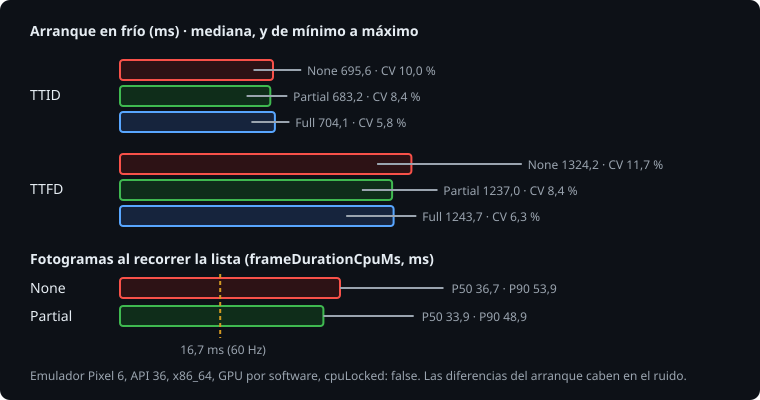

# Medir antes y después

> Un Baseline Profile se mete en el build para que la app vaya más rápida. ¿Va más rápida? Macrobenchmark lo puede medir en una sola ejecución, sin construir dos apps: compila la misma de tres formas y mide cada una. Esta teoría explica esas tres formas, enseña lo que dieron en el emulador y cómo leerlo sin engañarse.

## 🎯 Objetivos

- Elegir el `CompilationMode` de cada medida
- Comparar sin perfil, con perfil y todo compilado en el mismo benchmark
- Decidir si una diferencia es una mejora o ruido
- Saber qué hace falta para que los números sirvan para decidir



## 1. Tres compilaciones

Antes de medir, Macrobenchmark reinicia la compilación de la app y la deja como se le pide:

| `CompilationMode` | Qué simula |
| --- | --- |
| `None()` | Recién instalada sin perfil: todo interpretado y JIT. El peor caso |
| `Partial(BaselineProfileMode.Require)` | Recién instalada con el Baseline Profile, como desde Play. Falla si el APK no lo trae |
| `Full()` | Todo compilado por adelantado. El techo: más rápido no va a ir |

```kotlin
@Test fun withoutProfile() = startup(CompilationMode.None())
@Test fun withBaselineProfile() = startup(CompilationMode.Partial(BaselineProfileMode.Require))
@Test fun fullyCompiled() = startup(CompilationMode.Full())
```

Tres tests con la misma función: lo único que cambia es la compilación. `Require` asegura que se está midiendo con perfil; con `BaselineProfileMode.UseIfAvailable`, un APK sin perfil se mediría sin él.

## 2. Lo que dio el emulador

> 🔬 Medido en un emulador Pixel 6, API 36, x86_64, con 4 núcleos y la GPU por software, `cpuLocked: false`. 15 arranques en frío por modo:

| | TTID mediana | CV | TTFD mediana | CV |
| --- | --- | --- | --- | --- |
| `None` | 695,6 ms | 10,0 % | 1 324,2 ms | 11,7 % |
| `Partial` (perfil) | 683,2 ms | 8,4 % | 1 237,0 ms | 8,4 % |
| `Full` | 704,1 ms | 5,8 % | 1 243,7 ms | 6,3 % |

> 🔬 Y 5 recorridos de la lista de 40 por modo, con los fotogramas de todos juntos:

| | `frameDurationCpuMs` P50 | P90 | P99 | `frameOverrunMs` P50 |
| --- | --- | --- | --- | --- |
| `None` | 36,7 ms | 53,9 ms | 63,9 ms | 30,0 ms |
| `Partial` (perfil) | 33,9 ms | 48,9 ms | 57,1 ms | 25,0 ms |

Cómo se lee:

- **El primer fotograma no cambia.** −1,8 % con perfil, con un ruido del 8 al 10 %. Y `Full` sale *más lento* que `None`: con este ruido, el orden entre los tres es azar.
- **La pantalla completa, tampoco se puede decir.** −6,6 %, pero sin perfil el CV es del 11,7 %. El ejercicio 01 lo clasifica como `TOO_NOISY`.
- **Los fotogramas mejoran en las dos ejecuciones** que se hicieron: P50 de 35,2 a 33,0 ms en la primera, de 36,7 a 33,9 en la segunda. Es la pista más clara, y aun así es un emulador.
- **Todos los fotogramas llegan tarde.** Un P50 de 34 ms es el doble del plazo de 16,7 ms. Es la GPU por software: ningún perfil arregla eso.
- **Una ejecución de 10 iteraciones dio lo contrario.** TTID 686 ms sin perfil y 717 con él. Con este ruido, cambiar las iteraciones cambia la conclusión.

La documentación de Android habla de un código un 30 % más rápido desde el primer arranque con Baseline Profiles, en móviles reales. En este emulador no se ve, y no se presenta como si se viera.

## 3. Cuándo una diferencia es una mejora

Una regla sencilla, la del ejercicio 01:

1. Si el CV de antes o el de después pasa del 10 %, **no se concluye nada**: más iteraciones, o un dispositivo más estable.
2. Si la mediana cambia menos de un 5 %, **es ruido**.
3. Si no, es una mejora o un empeoramiento.

No es estadística seria (no hay un test de hipótesis), pero evita los dos errores típicos: celebrar ruido y no ver un empeoramiento real. Para algo más serio, las medidas de cada iteración están en el JSON, y se puede pasarles un test como el de Mann-Whitney.

## 4. Para que los números sirvan

| Hace falta | Por qué |
| --- | --- |
| Un móvil real, siempre el mismo | El emulador comparte CPU con tu máquina y pinta por software |
| La CPU bloqueada (`cpuLocked`) | Si la frecuencia sube y baja, el tiempo también. Bloquearla necesita root |
| La batería cargada, el móvil frío | Con calor, Android baja la frecuencia (`thermalThrottleSleepSeconds` en el JSON) |
| Las mismas iteraciones, el mismo recorrido | Si no, no es la misma medida |
| Antes y después en la misma ejecución | `CompilationMode` lo hace sin construir dos apps |

El JSON lo apunta en `context`: modelo, núcleos, frecuencia máxima, si la CPU estaba bloqueada. Un número sin su `context` no se puede comparar con nada.

## 5. Medir en CI

Lo habitual en un equipo:

- **En cada pull request**: compilar los benchmarks y el generador. En la Bitácora, ya lo hace `./gradlew build`.
- **Antes de cada versión**: regenerar el perfil en un GMD (`generateBaselineProfile`) y revisar su diff.
- **Cada noche, en un móvil real** (un laboratorio de dispositivos o Firebase Test Lab): ejecutar los benchmarks, guardar el JSON y avisar si la mediana empeora más de lo que permite el ruido.

## ⚠️ Errores comunes

| Error | Qué pasa | Arreglo |
| --- | --- | --- |
| Comparar dos ejecuciones de días distintos | El móvil no estaba igual | Los tres modos en la misma ejecución |
| `UseIfAvailable` | Sin perfil en el APK, mide sin él | `Require` |
| Concluir con un CV del 12 % | La diferencia cabe en el ruido | Más iteraciones, un móvil, la CPU bloqueada |
| Contar la mejora de `Full` | Ninguna app instalada está así | `Full` es el techo, no un objetivo |
| Publicar los números del emulador | No son los de nadie | Decir de dónde son, o medir en un móvil |

## 📝 Resumen

- `None`, `Partial` con `Require` y `Full`: el suelo, el perfil y el techo, en la misma ejecución.
- En el emulador, el arranque no cambia más que el ruido; la mediana de los fotogramas mejora un 6 a 8 % en las dos ejecuciones.
- Mediana para comparar, CV para saber si se puede, y una regla escrita antes de mirar.
- Para decidir de verdad: un móvil real, la CPU bloqueada y el `context` junto a cada número.

## 🔗 Recursos

- [Medir un Baseline Profile](https://developer.android.com/topic/performance/baselineprofiles/measure-baselineprofile)
- [`CompilationMode`](https://developer.android.com/reference/kotlin/androidx/benchmark/macro/CompilationMode)
- [Benchmarks en CI](https://developer.android.com/topic/performance/benchmarking/benchmarking-in-ci)
