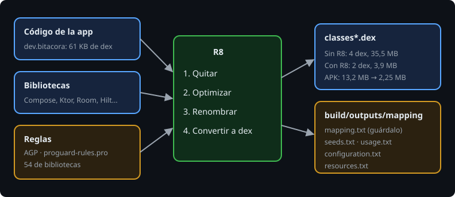

# R8

> La Bitácora llega al APK de release con todo lo que traen sus bibliotecas, se use o no: Compose entero, Ktor entero, los servicios de Google. **R8** es el compilador que convierte el bytecode en dex para la release, y por el camino quita lo que nadie usa, simplifica lo que queda y le cambia los nombres por otros cortos. En la Bitácora, el APK pasa de 13,2 MB a 2,25 MB. Esta teoría explica qué hace R8, cómo se enciende y qué cuesta.

## 🎯 Objetivos

- Explicar las cuatro cosas que hace R8: quitar, optimizar, renombrar y convertir a dex
- Encender R8 en la release con `isMinifyEnabled` e `isShrinkResources`, y saber por qué no en debug
- Saber qué es el modo completo (*full mode*) y por qué es el de siempre en AGP 9
- Leer lo que deja R8 en `build/outputs/mapping`
- Conocer los números de la Bitácora antes y después



## 1. Lo que hace R8

Sin R8, D8 convierte a dex **todas** las clases del programa: las de la app y las de cada biblioteca. Con R8, antes de convertir:

| Paso | Qué hace | En la Bitácora |
| --- | --- | --- |
| **Quitar** (*shrinking*) | Parte de los puntos de entrada (la actividad, el `Application`, el worker) y sigue cada llamada. Lo que no alcanza, no va | `AppModule`, las fábricas de Hilt: 810 clases marcadas `R8$$REMOVED$$CLASS` en el mapping, 21 de ellas de `dev.bitacora` |
| **Optimizar** | Mete un método dentro de quien lo llama (*inlining*), quita ramas que nunca se toman, junta clases | `SessionKt.reduce` acaba dentro de `BitacoraViewModel.onIntent` |
| **Renombrar** (*obfuscation*) | Cambia los nombres por otros de una o dos letras | `dev.bitacora.BitacoraViewModel` pasa a ser `fk` |
| **Convertir a dex** | Lo que hacía D8 | 2 archivos dex en lugar de 4 |

Renombrar no es para esconder el código (se lee igual con un descompilador): es para que ocupe menos. El dex guarda cada nombre como texto, y con decenas de miles de clases, métodos y campos, `fk` en lugar de `dev/bitacora/BitacoraViewModel` se nota.

Quitar recursos va aparte, con `isShrinkResources`: después de R8, AGP mira qué recursos siguen nombrados en el código o en otros recursos, y quita los demás.

## 2. Encenderlo

En la Bitácora, en el plugin de convención de las apps (`bitacora.android-application`), para toda app que lo use:

```kotlin
buildTypes {
    release {
        isMinifyEnabled = true
        isShrinkResources = true
        proguardFiles(getDefaultProguardFile("proguard-android-optimize.txt"), "proguard-rules.pro")
    }
}
```

- `isMinifyEnabled` enciende R8. Sin él, `isShrinkResources` falla al configurar: `Removing unused resources requires unused code shrinking to be turned on` (medido). Quita los recursos según el código que queda.
- `proguard-android-optimize.txt` son las reglas de AGP: los métodos nativos, los `enum`, los `Parcelable`, `@Keep`. AGP 9.4.1 lo extrae en `app/build/intermediates/default_proguard_files`; tiene 72 líneas.
- `proguard-rules.pro` son las reglas de la app. Si lo nombras y no existe, el build falla con `Supplied proguard configuration does not exist: .../app/proguard-rules.pro` (medido). En la Bitácora existe, y está vacío a propósito (teoría 02).

**Solo en release.** En debug, R8 alargaría cada compilación (`assembleFieldRelease` de la Bitácora, con R8, tardó 55 s) y el depurador vería `fk.e` en lugar de `BitacoraViewModel.onIntent`. El precio: lo que R8 rompe solo se ve en release. Por eso los benchmarks (`benchmarkRelease`, que copia la release) pasan por R8, y se ejecutan en un dispositivo.

> **El nombre**: R8 lee las reglas de ProGuard, el que se usaba antes. De ahí `proguardFiles`, `proguard-rules.pro` y `-keep`. ProGuard ya no se usa en Android; su formato de reglas, sí.

## 3. El modo completo

Desde AGP 8, R8 trabaja en **modo completo**: supone menos cosas. En el modo de compatibilidad, mantenía los constructores sin argumentos y los atributos de las clases que una regla nombraba, aunque la regla no lo pidiera, como hacía ProGuard. En modo completo, solo lo que la regla dice. Las reglas de una biblioteca escritas para ProGuard pueden quedarse cortas.

Se puede volver al de compatibilidad con `android.enableR8.fullMode=false` en `gradle.properties`. AGP 9.4.1 avisa: `The option setting 'android.enableR8.fullMode=false' is deprecated`. Y conserva más: el APK del ejercicio 02 pasó de 765 225 a 863 529 bytes (medido). No lo hagas: es tapar una regla que falta.

## 4. Lo que deja

En `app/build/outputs/mapping/fieldRelease/`, cada vez que R8 pasa:

| Archivo | Qué tiene | En la Bitácora |
| --- | --- | --- |
| `mapping.txt` | Cada nombre de antes y el de después, con sus líneas | 345 060 líneas |
| `seeds.txt` | Lo que las reglas mandan conservar | 1 166 líneas |
| `usage.txt` | Lo que R8 ha quitado | 69 621 líneas |
| `configuration.txt` | Todas las reglas juntas, con de dónde sale cada una | 1 089 líneas, de 58 archivos |
| `resources.txt` | Cada recurso, y si alguien lo usa | 1 505 líneas |
| `configanalyzer.html` | Las reglas, analizadas: cuánto conserva cada una | 366 KB |

`mapping.txt` es el que hay que guardar de cada versión publicada (teoría 04). Los demás son para entender qué ha pasado.

## 5. Los números de la Bitácora

La de field en release, con AGP 9.4.1 y R8 9.4.24, medida con `apkanalyzer` (teoría 05):

| | Sin R8 | Con R8 |
| --- | --- | --- |
| APK | 13 225 377 bytes | 2 254 321 bytes |
| Descarga (comprimida, lo que baja de Play) | 12 848 585 bytes | 2 070 138 bytes |
| Archivos dex | 4, 35,5 MB | 2, 3,9 MB |
| Referencias a métodos | 199 762 | 30 326 |
| `resources.arsc` | 150 764 bytes | 32 260 bytes |
| Archivos en el APK | 522 | 138 |

Un 83 % menos de APK sin una sola regla propia. Casi todo es código de las bibliotecas que la Bitácora no llama.

Con 199 762 referencias a métodos, la release necesitaba 4 dex: cada uno admite 65 536. Con R8, 2.

## ⚠️ Errores comunes

| Error | Por qué |
| --- | --- |
| Probar R8 solo con `./gradlew assembleRelease` | Que compile no dice que funcione: lo que se carga por reflexión falla al ejecutar. Hay que abrir la app en release |
| `isShrinkResources` sin `isMinifyEnabled` | `Removing unused resources requires unused code shrinking to be turned on` |
| Volver al modo de compatibilidad porque algo falla | Esconde una regla que falta; la siguiente versión de la biblioteca puede no tenerla tampoco |
| R8 en debug "para probarlo siempre" | Compilar es más lento, y el depurador ve nombres cambiados. Para eso están `benchmarkRelease` y los tests en release |

## 🧪 Comprueba que lo entendiste

1. ¿Qué hace R8 que D8 no hace? ¿Qué parte de lo que hace es la que más reduce la Bitácora?
2. ¿Por qué `isShrinkResources` necesita `isMinifyEnabled`?
3. ¿Qué cambia el modo completo, y por qué no conviene apagarlo?
4. ¿Cuál de los archivos de `build/outputs/mapping` hay que guardar al publicar?

---

← [Volver a la semana](../README.md) · Siguiente: [02 · Reglas keep](02-reglas-keep.md)
