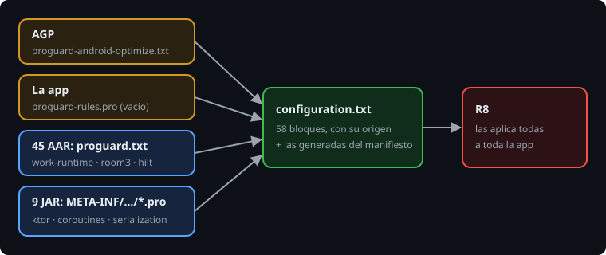

# Las reglas de las bibliotecas

> Quien usa la reflexión sabe qué hay que conservar. Si Room crea `BitacoraDatabase_Impl` por su nombre, la regla la escribe Room, no tú. Una biblioteca de Android lleva sus reglas dentro del AAR, y una de Kotlin o Java, dentro del JAR. R8 las junta con las de AGP y las de la app. En la Bitácora llegan de 54 archivos. Esta teoría explica cómo viajan, cómo escribe las suyas una biblioteca tuya, y qué traen las de la Bitácora.

## 🎯 Objetivos

- Saber dónde lleva sus reglas un AAR y dónde un JAR
- Escribir las reglas de una biblioteca propia con `consumerProguardFiles`
- Leer `configuration.txt` para ver qué regla llega de dónde
- Saber qué traen kotlinx.serialization, Ktor, Room, Hilt y WorkManager



## 1. Cómo viajan

| Biblioteca | Dónde van sus reglas | Cómo se ponen |
| --- | --- | --- |
| De Android (AAR) | `proguard.txt`, en la raíz del AAR | `consumerProguardFiles("consumer-rules.pro")` en su `build.gradle.kts` |
| De la JVM (JAR) | `META-INF/proguard/*.pro` | En `src/main/resources/META-INF/proguard/` |
| De la JVM, por versión de R8 | `META-INF/com.android.tools/r8-from-X/*.pro`, `r8-upto-X/`, `r8/` | Igual, en `resources` |

Las de un JAR pueden ir por versión: kotlinx-coroutines trae `r8/coroutines.pro` y `r8-from-1.6.0/coroutines.pro`, y R8 elige según la suya. ProGuard lee `META-INF/proguard/` y R8 prefiere `META-INF/com.android.tools/` si existe.

Las reglas de una biblioteca afectan a **toda la app**, no solo a la biblioteca. Una biblioteca con `-keep class ** { *; }` en sus reglas apaga R8 para todo el mundo. Por eso las reglas de una biblioteca tienen que ser tan pequeñas como las de la app, o más.

## 2. Las tuyas

En el ejercicio 02, la biblioteca `:sensors` crea las sondas de la app por el nombre de su clase. La regla va con ella:

```kotlin
// sensors/build.gradle.kts
android {
    defaultConfig {
        consumerProguardFiles("consumer-rules.pro")
    }
}
```

```
# sensors/consumer-rules.pro
-keep class * implements dev.bitacora.sensors.Probe {
    <init>();
}
```

`sensors-release.aar` lleva entonces un `proguard.txt` de 284 bytes con esa regla (medido), y la app que lo usa no tiene que saber nada. Sin `consumerProguardFiles`, R8 quita las sondas de la app (`dev.bitacora.Humidity` en `usage.txt`), porque nadie las nombra en el código.

No confundas `consumerProguardFiles` con `proguardFiles` en una biblioteca. `proguardFiles` es para cuando la biblioteca se pasa por R8 ella sola, lo que casi nunca se hace: se reduce en la app.

Los módulos `:core:*` de la Bitácora son de la JVM. Si uno necesitara reglas, irían en `src/main/resources/META-INF/proguard/`. Hoy ninguno lo necesita.

## 3. Las de la Bitácora

Al principio de cada bloque, `configuration.txt` dice de dónde viene:

```
# The proguard configuration file for the following section is .../transformed/work-runtime-2.12.0/proguard.txt
```

En la release de field hay 58 bloques (medido): las reglas de AGP, el `proguard-rules.pro` de la app, las que AGP genera del manifiesto y los layouts, y **54 de bibliotecas**: 45 `proguard.txt` de AAR y 9 archivos de JAR.

Lo que traen las que importan aquí:

| Biblioteca | Lo que conserva, y por qué |
| --- | --- |
| kotlinx.serialization (`kotlinx-serialization-common.pro`) | El `Companion` de cada clase `@Serializable`: `serializer()` se busca allí |
| Ktor (`ktor.pro`) | Los campos `volatile` de `io.ktor.**` (los usan sus atómicos) y los `HttpClientEngineContainer` que busca `ServiceLoader` |
| Room (`room3-runtime`) | El constructor de toda clase que extiende `RoomDatabase`: crea el `_Impl` por reflexión |
| Hilt (`hilt-android`) | Los *entry points*, con `allowobfuscation` y `allowshrinking`: si quedan, que no se rompan, sin conservar nombres |
| WorkManager (`work-runtime`) | El nombre y el constructor de los `ListenableWorker` |

Las de Hilt son el modelo: conservan lo justo y dejan a R8 renombrar y quitar.

## 4. Lo que hay que mirar al subir una versión

Las reglas cambian con cada versión de la biblioteca, y nadie lo anuncia. Al subir una:

1. Compara `configuration.txt` antes y después: `diff` de los dos bloques.
2. Mira `seeds.txt`: ¿conserva lo mismo?
3. Ejecuta la release. Los tests de la release (`ShrinkTest`, los benchmarks) lo hacen por ti.

## ⚠️ Errores comunes

| Error | Por qué |
| --- | --- |
| La regla de la reflexión de una biblioteca, en el `proguard-rules.pro` de la app | Cada app que la use tendrá que descubrirla al fallar |
| `proguardFiles` en lugar de `consumerProguardFiles` en la biblioteca | La regla no viaja en el AAR |
| Reglas de biblioteca con `{ *; }` | Apagan R8 en la clase entera, en todas las apps que la usen |
| Las reglas de un módulo de la JVM en un `consumer-rules.pro` | Un módulo `kotlin("jvm")` no tiene `consumerProguardFiles`: van en `META-INF/proguard` |

## 🧪 Comprueba que lo entendiste

1. ¿Dónde lleva sus reglas un AAR? ¿Y un JAR?
2. ¿Por qué la regla de `:sensors` va en `:sensors` y no en la app?
3. ¿Qué te dice `configuration.txt` que no te diga `seeds.txt`?
4. Elige una biblioteca de la Bitácora y explica qué conservan sus reglas y por qué.

---

← [02 · Reglas keep](02-reglas-keep.md) · Siguiente: [04 · El mapping y retrace](04-mapping-y-retrace.md)
