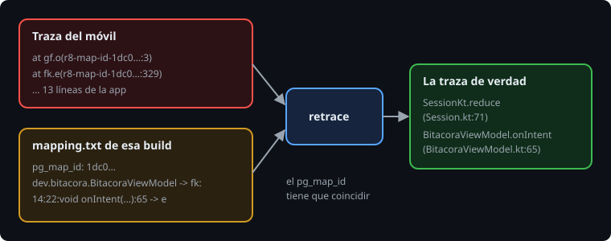

# El mapping y retrace

> Cuando la release falla en el móvil de alguien, la traza dice `at fk.e(r8-map-id-1dc0…:329)`. Para saber que es `BitacoraViewModel.onIntent`, línea 65, hace falta el **mapping** de esa versión y **retrace**, que lo lee. Esta teoría explica qué guarda el mapping, cómo se usa retrace y qué hay que guardar al publicar.

## 🎯 Objetivos

- Leer las líneas de clase y de método de `mapping.txt`
- Recuperar una traza con `retrace`
- Saber qué es el `pg_map_id` y por qué la traza lo lleva
- Guardar el mapping de cada versión, y subirlo a Play



## 1. Una traza de la release

Para verla, se provocó un fallo en la Bitácora en release: un `error("A crash to retrace")` dentro de `reduce` al añadir la observación "crash". En el emulador, `adb logcat -b crash`:

```
java.lang.IllegalStateException: A crash to retrace
	at gf.o(r8-map-id-1dc0194b32d1cce3a7cfc9696415d770cf361f2b92425c4a43a475172a783873:3)
	at fk.e(r8-map-id-1dc0194b…:329)
	at ym1.j(r8-map-id-1dc0194b…:70)
	at vb.b(r8-map-id-1dc0194b…:358)
	at zt.T0(r8-map-id-1dc0194b…:16)
	...
	at u5.dispatchTouchEvent(r8-map-id-1dc0194b…:78)
	at android.view.ViewGroup.dispatchTransformedTouchEvent(ViewGroup.java:3146)
```

Las clases de Android conservan sus nombres: no están en el APK, están en el móvil. Las de la app y las bibliotecas no. Donde iba el archivo fuente, R8 pone `r8-map-id-` y el identificador del mapping que generó ese APK.

## 2. El mapping

Empieza con una cabecera:

```
# compiler: R8
# compiler_version: 9.4.24
# min_api: 26
# pg_map_id: 1dc0194b32d1cce3a7cfc9696415d770cf361f2b92425c4a43a475172a783873
```

El `pg_map_id` es el de la traza: así se sabe qué mapping corresponde a qué traza. Luego, una clase por bloque:

```
dev.bitacora.BitacoraViewModel -> fk:
# {"id":"sourceFile","fileName":"BitacoraViewModel.kt"}
    kotlinx.coroutines.flow.MutableStateFlow _state -> e
    5:13:void onIntent(dev.bitacora.BitacoraIntent):64:64 -> e
    14:22:dev.bitacora.Next dev.bitacora.SessionKt.reduce(dev.bitacora.BitacoraUiState,dev.bitacora.BitacoraIntent):0:0 -> e
    14:22:void onIntent(dev.bitacora.BitacoraIntent):65 -> e
```

- `nombre de antes -> nombre de después:` abre la clase.
- Un campo: tipo, nombre de antes, `->`, nombre de después.
- Un método: `5:13:` son las líneas de **después** (las que salen en la traza), y `:64:64` las de antes. Las líneas 5 a 13 de `fk.e` son la línea 64 de `onIntent`.
- Varias líneas con el mismo rango son un método metido dentro de otro (*inlining*): las líneas 14 a 22 de `fk.e` son `reduce`, que R8 metió en `onIntent`, llamado desde la línea 65.
- `R8$$REMOVED$$CLASS$$591` es una clase que R8 quitó entera.

Leer un mapping a mano para una traza de verdad no es viable: en la Bitácora tiene 345 060 líneas, y R8 mueve código de una clase a otra. El `gf.o` de arriba es un método que R8 sintetizó (marcado `com.android.tools.r8.synthesized`), dentro de una clase sintética que en el mapping aparece como `Arrangement$$ExternalSyntheticLambda0`, de Compose. Para eso está retrace.

## 3. retrace

Viene con las herramientas del SDK (`cmdline-tools/latest/bin/retrace`):

```bash
retrace app/build/outputs/mapping/fieldRelease/mapping.txt traza.txt
```

Con la traza de arriba (medido):

```
java.lang.IllegalStateException: A crash to retrace
	at dev.bitacora.SessionKt.reduce(Session.kt:71)
	at dev.bitacora.BitacoraViewModel.onIntent(BitacoraViewModel.kt:65)
	at dev.bitacora.MainActivity.onCreate$lambda$1$6$2$0$2$0(MainActivity.kt:122)
	at dev.bitacora.BitacoraScreenKt.BitacoraScreen$lambda$5$0$0$3$0$0(BitacoraScreen.kt:90)
	at androidx.compose.foundation.AbstractClickableNode.performClick(AbstractClickableNode.java:1701)
	...
```

`Session.kt:71` es justo la línea del `error`. De 13 líneas ofuscadas salen 15: el método sintético desaparece, y los métodos metidos en otros vuelven a tener su línea.

**Sin ninguna regla.** Muchas guías piden `-keepattributes SourceFile,LineNumberTable` para que la traza tenga líneas. En la Bitácora no hizo falta: la traza lleva las líneas de después, y el mapping las traduce a las del código. Ni las reglas de AGP 9.4.1 ni las de la app tienen esa regla, y retrace dio la línea exacta (medido).

En Android Studio, *Analyze Stack Trace* hace lo mismo con el mapping del proyecto.

## 4. Guardar el mapping

Cada build de release genera su mapping: la release de field sin el `error` tiene otro, con `pg_map_id: 5560324e…`. Si no guardas el de la versión publicada, sus trazas no se pueden leer nunca más.

- **Play** lo pide: al subir el AAB, AGP lo incluye dentro (`BUNDLE-METADATA/com.android.tools.build.obfuscation/proguard.map`). La consola de Play muestra las trazas de Android vitals ya recuperadas.
- **Fuera de Play** (Firebase Crashlytics, Sentry): su plugin de Gradle lo sube en cada build de release.
- **En CI**, guárdalo como artefacto, junto al APK o el AAB.

## ⚠️ Errores comunes

| Error | Por qué |
| --- | --- |
| Pasar a retrace el mapping de otra build | Da nombres equivocados con toda tranquilidad. Compara el `pg_map_id` de la traza con el del mapping |
| `-keepattributes SourceFile,LineNumberTable` "por si acaso" | En la Bitácora no hizo falta: el mapping ya traduce las líneas |
| No guardar el mapping de una versión publicada | Las trazas de esa versión ya no se pueden leer |
| `-dontobfuscate` para leer las trazas | Renunciar a parte de lo que reduce R8 por no guardar un archivo |

## 🧪 Comprueba que lo entendiste

1. En una línea de método del mapping, ¿qué son los dos rangos de números?
2. ¿Cómo sabes qué mapping corresponde a una traza?
3. ¿Por qué de 13 líneas ofuscadas retrace saca 15?
4. ¿Dónde guarda AGP el mapping para Play?

---

← [03 · Las reglas de las bibliotecas](03-reglas-de-las-bibliotecas.md) · Siguiente: [05 · APK Analyzer](05-apk-analyzer.md)
