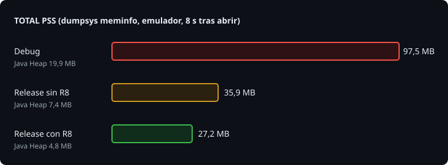

# La memoria

> Una app que ocupa poco en el APK puede ocupar mucho en el móvil. Y una que funciona bien puede retener en memoria pantallas que ya se cerraron, hasta que Android la mata. Esta teoría mide la memoria de la Bitácora, busca fugas con **LeakCanary**, también en los tests del dispositivo, y usa **StrictMode** para ver qué hace la app en el hilo principal que no debería. El **Memory Profiler** de Android Studio queda para mirar lo que estos encuentran.

## 🎯 Objetivos

- Medir la memoria de una app con `dumpsys meminfo` y leer PSS, el heap de Java y el código
- Explicar qué es una fuga en Android y cómo la detecta LeakCanary
- Hacer que un test del dispositivo falle si deja una fuga, con `DetectLeaksAfterTestSuccess`
- Encender StrictMode en debug y leer lo que encuentra
- Saber qué da el Memory Profiler que no dan los otros



## 1. Medir

```bash
adb shell dumpsys meminfo dev.bitacora.agro
```

| Fila | Qué es |
| --- | --- |
| `TOTAL PSS` | La memoria de la app, con la compartida repartida entre quien la comparte. La que se compara |
| `Java Heap` | Los objetos de Kotlin y Java. Donde están las fugas |
| `Native Heap` | La de C y C++: la base de datos, las imágenes decodificadas |
| `Code` | El dex, el código compilado y las bibliotecas nativas, en memoria |

La Bitácora en el emulador de la semana 36, 8 s después de abrirla, con 3 arranques en frío (medido; el primero tras instalar sale más alto, y se descarta):

| | `TOTAL PSS` | `Java Heap` | `Code` |
| --- | --- | --- | --- |
| Debug (sin R8, depurable, con LeakCanary) | 97,5 MB | 19,9 MB | 1,9 MB |
| Release sin R8 | 35,9 MB | 7,4 MB | 11,5 MB |
| Release con R8 | 27,2 MB | 4,8 MB | 5,5 MB |

La debug ocupa más del triple: por eso la memoria, como el tiempo (semana 36), se mide en release. R8 baja la release un 24 %: menos código en memoria, y menos objetos en el heap.

## 2. Las fugas

En Kotlin no se libera memoria a mano: el recolector de basura (GC) libera lo que nadie apunta. Hay una **fuga** cuando algo que vive mucho (un `object`, un `companion`, un hilo) sigue apuntando a algo que debería haber muerto. El caso típico en Android es una actividad destruida: al girar el móvil, Android la destruye y crea otra. Si un `object` sigue apuntándola, la vieja no se libera, con todas sus vistas.

```kotlin
object Sensors {
    private val listeners = mutableListOf<(String) -> Unit>()
    fun subscribe(listener: (String) -> Unit) { listeners += listener }
}

class MainActivity : ComponentActivity() {
    private val listener: (String) -> Unit = { readings += it }   // apunta a la actividad
    override fun onCreate(savedInstanceState: Bundle?) {
        Sensors.subscribe(listener)                                  // y nadie la borra
    }
}
```

Lo que se apunta en `onCreate` se borra en `onDestroy` (o mejor: se apunta y se borra con el ciclo de vida, `DisposableEffect` en Compose, `repeatOnLifecycle` en un `Flow`).

## 3. LeakCanary

LeakCanary 2.14 (la última estable; la 3.0 sigue en alfa: la alfa 9 es de junio de 2026). Va solo en debug:

```kotlin
debugImplementation(libs.leakcanary.android)
```

No hace falta código: se arranca solo. Vigila actividades, fragmentos, vistas y `ViewModel` que se destruyen. Si 5 s después siguen en memoria, fuerza el GC; si siguen, vuelca el heap (`.hprof`), lo analiza en el móvil con su biblioteca, Shark, y muestra el camino desde la raíz del GC hasta el objeto retenido.

En la Bitácora: los 109 tests de Robolectric pasaron igual con LeakCanary en debug (medido). Y en el logcat de la debug aparecen sus accesos a la API oculta (`hiddenapi: Accessing hidden field Landroid/app/ActivityThread;->mH`): así se entera de cada actividad que se destruye.

### En los tests del dispositivo

`leakcanary-android-instrumentation` trae una regla de JUnit:

```kotlin
@get:Rule(order = 1)
val leaks = DetectLeaksAfterTestSuccess()

@get:Rule(order = 2)
val rule = createAndroidComposeRule<MainActivity>()
```

Si el test pasa, busca objetos retenidos y falla con el informe. Va por fuera de la regla de la actividad: cuando mira, la actividad ya está destruida.

Se comprobó metiendo una fuga a propósito en la Bitácora (una lista de nivel superior con la actividad dentro). Los dos tests de `DeviceTest` fallaron (medido):

```
leakcanary.NoLeakAssertionFailedError: Application memory leaks were detected:
425458 bytes retained by leaking objects
├─ dev.bitacora.MainActivityKt class
│    Leaking: NO (a class is never leaking)
│    ↓ static MainActivityKt.leaked
│                            ~~~~~~
├─ java.util.ArrayList instance
│    ↓ ArrayList[0]
╰→ dev.bitacora.MainActivity instance
     Leaking: YES (ObjectWatcher was watching this because dev.bitacora.MainActivity received
     Activity#onDestroy() callback and Activity#mDestroyed is true)
```

Se lee de abajo arriba: lo que se fuga (`Leaking: YES`), quién lo apunta, y lo subrayado con `~~~`, la referencia que probablemente sobra. Sin la fuga, los dos pasan en unos 6 s.

## 4. StrictMode

StrictMode es de Android: avisa cuando la app hace algo que no debería, como leer el disco en el hilo principal. En la Bitácora, en `BitacoraApp.onCreate`, solo en debug:

```kotlin
if (BuildConfig.DEBUG) {
    StrictMode.setThreadPolicy(StrictMode.ThreadPolicy.Builder().detectAll().penaltyLog().build())
    StrictMode.setVmPolicy(StrictMode.VmPolicy.Builder().detectAll().penaltyLog().build())
}
```

- `ThreadPolicy`: lo del hilo principal (disco, red, llamadas lentas).
- `VmPolicy`: lo de todo el proceso (objetos que se cierran mal, actividades que se fugan, archivos expuestos).
- `penaltyLog` escribe en el logcat (`StrictMode policy violation`); `penaltyDeath` cierra la app. Con `penaltyLog`, un aviso de una biblioteca no te para.

Al abrir la debug y añadir una observación salieron **10 avisos** (medido), todos `DiskReadViolation` o `DiskWriteViolation`, de dos sitios:

| Dónde | Qué |
| --- | --- |
| `AppModule.database` (`AppModule.kt:33`) | `context.getDatabasePath` comprueba la carpeta en el disco, en el hilo principal: Hilt crea la base de datos al crear el `ViewModel` |
| `io.ktor.serialization.kotlinx.ExtensionsJvmKt.<clinit>` | Ktor busca sus extensiones con `ServiceLoader`, que lee el APK, al crear el cliente |

Ninguno rompe nada, pero dicen que el primer `ViewModel` espera al disco. Arreglarlo es crear esas dependencias fuera del hilo principal (con `dagger.Lazy` y `Dispatchers.IO`, por ejemplo); la Bitácora lo deja anotado, y por eso usa `penaltyLog` y no `penaltyDeath`.

## 5. El Memory Profiler

En Android Studio, *Profiler → Memory*, con la app en un dispositivo y `profileable` (la `benchmarkRelease` de la semana 36 lo es). Da lo que los otros no:

- La memoria a lo largo del tiempo, con los GC marcados: una escalera que nunca baja es una fuga.
- Un volcado del heap para recorrerlo a mano: cuántas instancias de cada clase, quién las retiene.
- Las asignaciones (*allocation tracking*): quién crea objetos, y cuántos, mientras haces algo. Es lo que se mira cuando un scroll va a tirones por el GC.

LeakCanary dice **que** hay una fuga, y su camino. El Memory Profiler sirve para entender **por qué** la memoria crece cuando no hay una fuga clara.

## ⚠️ Errores comunes

| Error | Por qué |
| --- | --- |
| `implementation(libs.leakcanary.android)` | LeakCanary llega a la release. Va con `debugImplementation` |
| Medir la memoria en debug | El triple que la release, en la Bitácora |
| `DetectLeaksAfterTestSuccess` por dentro de la regla de la actividad | Mira antes de que la actividad se destruya |
| `penaltyDeath` con avisos de bibliotecas que no controlas | La debug no arranca. Primero `penaltyLog`, y se aprieta cuando la app esté limpia |
| StrictMode encendido en release | El usuario no lee el logcat, y `detectAll` cuesta |

## 🧪 Comprueba que lo entendiste

1. ¿Qué es `TOTAL PSS`? ¿Por qué se compara ese y no el tamaño del APK?
2. Explica una fuga de actividad: quién apunta a quién y por qué no se libera.
3. ¿Qué hace `DetectLeaksAfterTestSuccess`, y por qué va por fuera de la regla de la actividad?
4. ¿Qué encontró StrictMode en la Bitácora, y por qué se queda en `penaltyLog`?

---

← [05 · APK Analyzer](05-apk-analyzer.md) · [Volver a la semana](../README.md)
