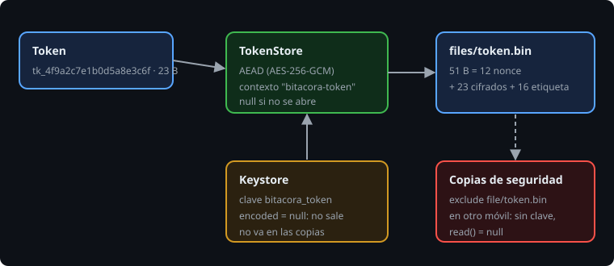

# El Keystore y Tink

> El token del servidor de campo vive en el móvil. Si va en claro en `files/`, quien tenga una copia de la carpeta de la app (una copia de seguridad, un móvil con root, un volcado) lo tiene. Cifrarlo es fácil; lo difícil es dónde guardar la clave. Android tiene un sitio para eso, el **Keystore**: la clave se crea dentro y nunca sale. **Tink** pone encima la criptografía bien hecha, sin elegir modos ni nonces a mano. Esta teoría explica los dos, por qué `EncryptedSharedPreferences` ya no es la respuesta, y cómo guarda la Bitácora su token.

## 🎯 Objetivos

- Saber qué protege el Keystore y qué no
- Cifrar con AEAD y explicar para qué sirve el contexto (los datos asociados)
- Guardar una clave de Tink cifrada con otra (el keyset y la clave maestra)
- Rotar una clave sin perder lo cifrado antes
- Saber por qué `EncryptedSharedPreferences` está obsoleta y qué se usa en su lugar



## 1. Qué hay que proteger, y de quién

Los archivos de `filesDir` solo los lee la app: otra app no puede. El peligro está en otro sitio:

| Quién | Cómo llega a los archivos |
| --- | --- |
| Una copia de seguridad | La de Google, o el paso a otro móvil, se llevan `files/` (teoría 05) |
| Un móvil con root, o un emulador | `adb shell`, como root, lee cualquier carpeta |
| Un volcado de la app | Las herramientas forenses copian la carpeta entera |

Cifrar el archivo con una clave que esté en otro archivo de la misma carpeta no arregla nada: quien se lleva uno se lleva el otro. La clave tiene que estar en un sitio del que **no se pueda copiar**.

## 2. El Keystore

`AndroidKeyStore` es un proveedor de la JCA que guarda claves fuera del proceso de la app, en un servicio del sistema y, si el móvil lo tiene, en hardware (TEE o StrongBox). La app pide «cifra esto con la clave `bitacora_token`» y recibe el resultado; la clave no pasa nunca por su memoria.

```kotlin
val key = KeyStore.getInstance("AndroidKeyStore").apply { load(null) }.getKey("bitacora_token", null)
key.encoded // null
```

🔬 En el emulador de la semana 36, `encoded` es `null`: no hay bytes que leer (`DeviceTest.theKeystoreKeepsTheToken`). La clave tampoco va a las copias de seguridad ni pasa a otro móvil. Lo cifrado con ella **solo se abre en este móvil**: si una copia se lleva el archivo cifrado, en el móvil nuevo no se puede abrir (teoría 05).

Lo que no hace: no esconde la clave de **tu propia app**. Quien controla el proceso (root, un depurador) puede pedir al Keystore que descifre. Protege la clave de ser copiada, no del uso.

## 3. AEAD

La criptografía que se usa para guardar datos es **AEAD** (*authenticated encryption with associated data*). Hace dos cosas:

- **Cifra**: sin la clave no se lee.
- **Autentica**: si alguien cambia un bit, descifrar falla. No devuelve basura: falla.

Y acepta unos **datos asociados**, que no se cifran pero se comprueban. En la Bitácora son `"bitacora-token"`: un texto cifrado para otra cosa, con la misma clave, no se abre como token.

| Lo que guarda | Bytes |
| --- | --- |
| Prefijo de Tink: versión e id de la clave | 5 |
| Nonce de AES-GCM | 12 |
| El texto cifrado | lo que mida el texto |
| Etiqueta de autenticación | 16 |

🔬 Con una clave de Tink, el token de 23 bytes ocupa 56: 23 + 33 (`TokenTest.theFileIsTheTokenPlus33Bytes`). Con la clave del Keystore, en el emulador, `files/token.bin` mide 51: 23 + 12 + 16. La `Aead` de `AndroidKeystore` es una sola clave y no lleva el prefijo. El nonce es aleatorio en cada cifrado: el mismo token cifrado dos veces sale distinto, y quien mira no sabe si se repite (ejercicio 01).

El nonce no se puede repetir con la misma clave. Con AES-GCM, dos mensajes con el mismo nonce dejan ver la combinación de los dos textos y permiten falsificar. Por eso no se escribe a mano: lo hace Tink.

## 4. Tink

Tink es la biblioteca de criptografía de Google. No te deja elegir el modo, el relleno o el nonce: eliges una **primitiva** (`Aead`, `Mac`, `DeterministicAead`, `StreamingAead`…) y unos **parámetros** con nombre (`AES256_GCM`), y Tink hace lo demás.

| Pieza | Qué es |
| --- | --- |
| `Aead` | La primitiva: `encrypt(texto, contexto)` y `decrypt(cifrado, contexto)` |
| `KeysetHandle` | Un conjunto de claves (un *keyset*): una primaria, con la que se cifra, y las de antes, para descifrar |
| `AeadConfig2026.get()` | La configuración: qué algoritmos acepta. Desde 1.24, se pasa a cada llamada en lugar del registro global |
| `TinkJsonProtoKeysetFormat` | Guardar y leer un keyset, cifrado con otra `Aead` |

```kotlin
val config = AeadConfig2026.get()
val handle = KeysetHandle.generateNew(PredefinedAeadParameters.AES256_GCM, config)
val aead = handle.getPrimitive(config, Aead::class.java)
val sealed = aead.encrypt("tk_live_4f9a2c7e1b".encodeToByteArray(), "token".encodeToByteArray())
```

🔬 En Tink 1.24.0, `KeysetHandle.generateNew(parametros)` sin configuración, `AeadConfig.register()` y `TinkJsonProtoKeysetFormat.parseEncryptedKeyset` sin configuración están `@Deprecated`. Con `allWarningsAsErrors`, el ejercicio 01 no compila si los usas.

### El keyset y la clave maestra

Una clave del Keystore es lenta (cada operación es una llamada a otro proceso) y admite pocas a la vez. El patrón de Tink para muchos datos es el **cifrado envolvente**: una clave de Tink cifra los datos, y la clave del Keystore (la **maestra**) cifra la de Tink. En disco queda el keyset cifrado:

```json
{"encryptedKeyset":"AeN7F5ZN…","keysetInfo":{"primaryKeyId":2233422671,"keyInfo":[{"typeUrl":"type.googleapis.com/google.crypto.tink.AesGcmKey","status":"ENABLED","keyId":2233422671,"outputPrefixType":"TINK"}]}}
```

🔬 Es lo que escribe la `Vault` del ejercicio 01: los ids y el tipo se ven, la clave no. Sin la maestra no se puede leer (`anotherMasterKeyCannotReadTheKeyset`).

### Rotar

Una clave nueva se añade al keyset y pasa a primaria; las de antes se quedan para descifrar. El prefijo de 5 bytes dice con qué clave se cifró cada texto, y Tink elige la buena:

```kotlin
handle = KeysetHandle.newBuilder(handle).setConfiguration(config)
    .addEntry(KeysetHandle.generateEntryFromParameters(PredefinedAeadParameters.AES256_GCM).withRandomId().makePrimary())
    .build()
```

🔬 Sin `setConfiguration(config)`, `build()` falla con `no key creator for this class was registered`: el builder no sabe crear la clave sin configuración.

## 5. Y `EncryptedSharedPreferences`

Durante años, la respuesta fue `androidx.security:security-crypto`: `EncryptedSharedPreferences` y `EncryptedFile`, con un `MasterKey` en el Keystore. 🔬 En la 1.1.0 (la última estable), `EncryptedSharedPreferences` y `MasterKey` están `@Deprecated`, y por dentro usan Tink 1.8.0. No se arreglan: se reemplazan.

Y la propia Tink, en `AndroidKeysetManager` (lo que usaba `security-crypto` por dentro): *«We don't recommend using this class. Instead, directly use AndroidKeystore»*. Lo que recomienda hoy:

| Caso | Qué usar |
| --- | --- |
| Un secreto pequeño (un token) | `AndroidKeystore.getAead(alias)`: cifrar directamente con la clave del Keystore |
| Muchos datos, o cifrar a menudo | Un keyset de Tink cifrado con `AndroidKeystore.getAead(alias)` como maestra (ejercicio 01) |
| Preferencias | DataStore con un `Serializer` que cifra y descifra con una `Aead` |

La Bitácora guarda un token, y lo cifra directamente con el Keystore:

```kotlin
fun keystoreAead(alias: String): Aead {
    if (!AndroidKeystore.hasKey(alias)) AndroidKeystore.generateNewAes256GcmKey(alias)
    return AndroidKeystore.getAead(alias)
}

class TokenStore(private val file: File, private val aead: Aead) {
    fun save(token: String) = file.writeBytes(aead.encrypt(token.encodeToByteArray(), CONTEXT))

    fun read(): String? = if (!file.isFile) null else try {
        aead.decrypt(file.readBytes(), CONTEXT).decodeToString()
    } catch (_: GeneralSecurityException) {
        null
    }
}
```

`TokenStore` recibe la `Aead`: en la app, la del Keystore; en Robolectric, que no tiene Keystore, una de Tink en memoria. 🔬 Con R8, Tink añade 1 796 bytes a la release (de 2 254 321 a 2 256 117): de toda la biblioteca solo queda `AndroidKeystore`.

## ⚠️ Errores comunes

| Error | Por qué |
| --- | --- |
| La clave en `strings.xml`, en `BuildConfig` o en un archivo junto a lo cifrado | Quien se lleva uno se lleva la otra |
| AES en modo ECB, o CBC sin MAC | ECB deja ver la forma de los datos; sin MAC, un cambio no se nota |
| Un nonce fijo, o un contador que se reinicia | Con GCM, repetir el nonce rompe el cifrado y la autenticación |
| Tragarse la excepción de descifrar y devolver `""` | El que llama no sabe que no hay token; devuelve `null` y que pida vincular otra vez |
| Abrir el Keystore en el hilo principal al arrancar | Es una llamada a otro proceso: `Lazy` y fuera del hilo principal |
| Seguir con `EncryptedSharedPreferences` en código nuevo | Está obsoleta |

## 🧪 Comprueba que lo entendiste

1. ¿De qué protege el Keystore, y de qué no?
2. ¿Qué dos cosas hace AEAD? ¿Para qué sirven los datos asociados?
3. ¿Por qué no se repite un nonce, y quién lo elige en Tink?
4. ¿Qué es el cifrado envolvente y por qué existe?
5. ¿Qué le pasa al token de la Bitácora si se restaura en otro móvil?

---

Siguiente: [02 · Network Security Config](02-network-security-config.md)
