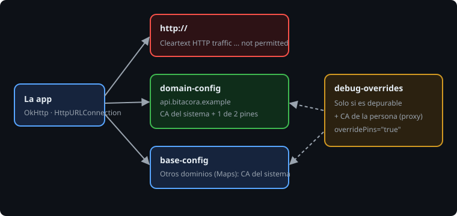

# Network Security Config

> Lo que la app acepta en la red se decide en un XML: si deja salir algo en claro, en qué certificados confía y, para un servidor concreto, qué claves acepta. Sin escribir código: Android lo aplica a `HttpURLConnection`, a OkHttp (el motor de Ktor en la Bitácora) y a todo lo que use la pila de TLS de la plataforma. Esta teoría explica sus tres partes, cómo se ve en el APK y el truco de la debug para mirar el tráfico con un proxy.

## 🎯 Objetivos

- Escribir un `network_security_config.xml` y conectarlo en el manifiesto
- Prohibir el tráfico en claro y saber qué pasa si la app lo intenta
- Decidir en qué autoridades confía la app, en release y en debug
- Leer la configuración compilada de un APK



## 1. Dónde va

```xml
<!-- AndroidManifest.xml -->
<application android:networkSecurityConfig="@xml/network_security_config">
```

```xml
<!-- res/xml/network_security_config.xml -->
<network-security-config>
    <base-config cleartextTrafficPermitted="false" />
    <domain-config>
        <domain includeSubdomains="false">api.bitacora.example</domain>
        <pin-set expiration="2027-12-01"></pin-set>
    </domain-config>
    <debug-overrides>
        <trust-anchors>
            <certificates overridePins="true" src="user" />
        </trust-anchors>
    </debug-overrides>
</network-security-config>
```

| Parte | Para qué |
| --- | --- |
| `base-config` | Lo de todos los dominios que no tienen el suyo |
| `domain-config` | Lo de unos dominios: en claro o no, sus autoridades, sus pines (teoría 03) |
| `debug-overrides` | Lo que se añade **solo si la app es depurable** (la debug) |

## 2. En claro

Con `targetSdk` 28 o más, el tráfico en claro (`http://`) ya está prohibido por defecto. Escribirlo en `base-config` lo deja visible y evita que alguien lo encienda sin querer con `android:usesCleartextTraffic="true"` en el manifiesto: con una configuración de red, ese atributo se ignora.

🔬 En el emulador, la app del ejercicio 02 pidiendo `http://example.com/`:

```
java.io.IOException: Cleartext HTTP traffic to example.com not permitted
```

No sale ni un byte: el sistema corta antes de abrir el socket. Por eso los tests del ejercicio 02 buscan además `http://alertas` en el dex: una URL en claro en el código es un fallo esperando a pasar.

Si un servidor de verdad solo habla `http`, se permite **ese** dominio en su `domain-config`, nunca en `base-config`.

## 3. En quién confía

Un certificado TLS vale si lo firma una autoridad (CA) de confianza. `trust-anchors` dice cuáles:

| `src` | Qué es |
| --- | --- |
| `system` | Las CA que trae Android. Por defecto, desde `targetSdk` 24 |
| `user` | Las que instala la persona en Ajustes. Por defecto, **no** desde `targetSdk` 24 |
| `@raw/mi_ca` | Una CA propia, en `res/raw` (un servidor interno) |

Confiar en las de la persona en release es abrir la puerta: quien instale una CA en el móvil (una empresa, un software malicioso, alguien con el móvil en la mano) puede leer y cambiar el tráfico de la app sin que se note.

### Debug: el proxy

Para depurar se pone un proxy en medio (mitmproxy, Charles, el inspector de red de Android Studio) con su propia CA instalada en el emulador. Eso es una CA de la persona: solo en `debug-overrides`.

```xml
<debug-overrides>
    <trust-anchors>
        <certificates overridePins="true" src="user" />
    </trust-anchors>
</debug-overrides>
```

`overridePins="true"`: el proxy no tiene la clave del servidor, y con pines no se podría mirar el tráfico de la API. Solo en la debug, y solo para las CA de la persona.

`debug-overrides` se aplica si la app es `android:debuggable`. La release no lo es: AGP lo pone en `debug` y no en `release`. `SecurityTest.userCertificatesOnlyInDebug` lo comprueba en los dos APK.

## 4. Lo que queda en el APK

El XML se compila, como los layouts. En la release, además, AGP acorta su ruta:

🔬 `apkanalyzer resources value --type xml --name network_security_config` devuelve `res/xml/network_security_config.xml` en la debug y `res/8G.xml` en la release del ejercicio 02.

Para leerlo:

```bash
apkanalyzer resources xml --file res/8G.xml app-release-unsigned.apk
aapt2 dump xmltree --file res/8G.xml app-release-unsigned.apk
```

🔬 `apkanalyzer` enseña los atributos pero pierde el texto de los nodos: `<domain includeSubdomains="false" />`, sin el dominio, y `<pin digest="SHA-256" />`, sin el pin. `aapt2 dump xmltree` los enseña como `T: 'api.bitacora.example'`. Por eso `theServerIsPinned` usa `aapt2`.

## ⚠️ Errores comunes

| Error | Por qué |
| --- | --- |
| `cleartextTrafficPermitted="true"` en `base-config` «para probar» | Se queda; y todo el tráfico de la app puede ir en claro |
| `<certificates src="user" />` en `base-config` | Cualquier CA instalada en el móvil lee el tráfico de la release |
| La configuración en `res/xml` pero sin `android:networkSecurityConfig` | Android no la busca: no hace nada |
| Un `TrustManager` que acepta todo, en código | Lo mismo que no tener TLS. Lint lo marca (`TrustAllX509TrustManager`) |
| Probar solo la debug | Con `debug-overrides`, la debug acepta lo que la release no |

## 🧪 Comprueba que lo entendiste

1. ¿Qué tres partes tiene la configuración y cuándo se aplica cada una?
2. ¿Qué pasa si la app pide `http://` con `cleartextTrafficPermitted="false"`? ¿Sale algo a la red?
3. ¿Por qué no se confía en las CA de la persona en release? ¿Y por qué sí en debug?
4. ¿Por qué el test de los pines usa `aapt2` y no `apkanalyzer`?

---

← [01 · El Keystore y Tink](01-keystore-y-tink.md) · Siguiente: [03 · Certificate pinning](03-certificate-pinning.md)
