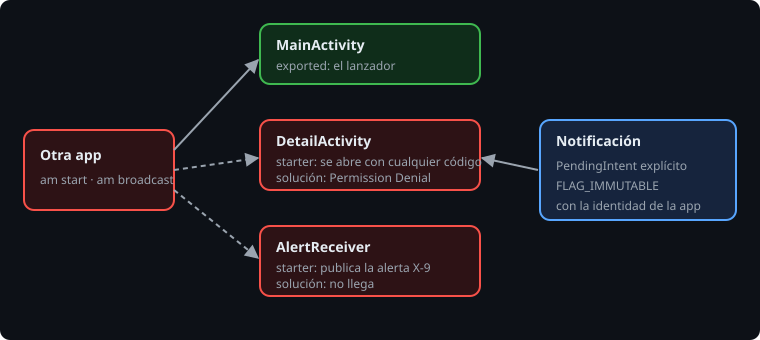

# Componentes exportados y PendingIntent

> Una app tiene puertas: cada actividad, servicio, receptor o proveedor con `android:exported="true"` se puede abrir desde cualquier otra app, con los datos que esa app quiera. Y un `PendingIntent` es una puerta al revés: le das a otro (el sistema de notificaciones) permiso para actuar como tu app. Esta teoría explica qué exportar, cómo tratar lo que entra por una puerta abierta, y cómo crear un `PendingIntent` que nadie pueda cambiar.

## 🎯 Objetivos

- Saber qué componentes exporta una app, los suyos y los de sus bibliotecas
- Cerrar lo que no necesita estar abierto, y proteger con un permiso lo que sí
- Tratar lo que llega por un enlace como lo que escribe un desconocido
- Crear un `PendingIntent` explícito e inmutable



## 1. `exported`

Desde Android 12 (`targetSdk` 31), un componente con `intent-filter` tiene que decir `android:exported`. Sin `intent-filter`, por defecto no se exporta.

| `exported` | Quién lo abre |
| --- | --- |
| `true` | Cualquier app, con cualquier extra |
| `true` con `android:permission` | Solo quien tenga ese permiso |
| `false` | Solo tu app (y el sistema) |

🔬 Con el starter del ejercicio 02 instalado, desde `adb shell` (que para la app es un extraño):

```
$ am start -n dev.bitacora.alertas/.DetailActivity --es code FALSA
Starting: Intent { cmp=dev.bitacora.alertas/.DetailActivity (has extras) }
$ am broadcast -n dev.bitacora.alertas/.AlertReceiver --es code X-9 --es text falsa
Broadcast completed: result=0
```

El detalle se abre con el código que quiera quien llama, y aparece una notificación de alerta `X-9` que la app nunca generó. Con la solución (`exported="false"` en los dos):

```
java.lang.SecurityException: Permission Denial: starting Intent { … cmp=dev.bitacora.alertas/.DetailActivity (has extras) } from null (pid=4906, uid=2000) not exported from uid 10228
```

y ninguna notificación. La app sigue mandándose sus alertas: `sendBroadcast(Intent(NEW_ALERT).setPackage(packageName))` llega a un receptor no exportado de la misma app.

### Lo que exportan las bibliotecas

El manifiesto que cuenta es el **fusionado**. 🔬 En la release de field de la Bitácora:

| Componente | Exportado | Permiso |
| --- | --- | --- |
| `dev.bitacora.MainActivity` | sí | ninguno: el lanzador y los enlaces |
| `androidx.work.impl.background.systemjob.SystemJobService` | sí | `BIND_JOB_SERVICE`: solo el sistema |
| `androidx.work.impl.diagnostics.DiagnosticsReceiver` | sí | `DUMP`: solo `adb` y el sistema |
| `androidx.profileinstaller.ProfileInstallReceiver` | sí | `DUMP` |

En la debug, además, `androidx.activity.ComponentActivity` (de `ui-test-manifest`) y dos actividades de LeakCanary, sin permiso. Es otra razón para que lo de debug no llegue a la release. `SecurityTest.onlyTheLauncherIsOpenToEveryone` mira la release: exportado y sin permiso, solo `MainActivity`.

```bash
apkanalyzer manifest print app-field-release-unsigned.apk | grep -B3 'exported="true"'
```

## 2. Lo que entra por una puerta abierta

`MainActivity` tiene que estar abierta: es el lanzador y recibe `bitacora://observation/A-2`. Desde esta semana recibe también `bitacora://pair?token=…`, que vincula el móvil con el servidor de campo. Cualquier página web puede abrir ese enlace.

Lo que llega por un componente exportado (extras, la URI, un archivo compartido) se trata como lo que escribe un desconocido:

1. **Validar la forma**: `pairingToken` solo acepta `[A-Za-z0-9_-]{20,200}`, y solo con el esquema y el host esperados. Un token con `"><script>` no llega a ningún sitio.
2. **Confirmar lo que cambia algo**: sin confirmación, una página podría vincular el móvil con *su* cuenta, y las observaciones de la persona irían a ella. La Bitácora pregunta con un snackbar, «¿Vincular este móvil con el servidor?», y solo guarda al tocar *Vincular*.
3. **No confiar en quién llama**: `getCallingPackage()` solo existe si la otra app usó `startActivityForResult`, y un enlace del navegador no dice de qué página viene.

## 3. `PendingIntent`

Un `PendingIntent` es un `Intent` que otro ejecuta **con la identidad de tu app**. La notificación de una alerta lleva uno: al tocarla, el sistema abre el detalle como si lo abriera la app, aunque `DetailActivity` no esté exportada.

Dos preguntas:

| Pregunta | Mal | Bien |
| --- | --- | --- |
| ¿A quién va? | Implícito: `Intent("dev.bitacora.alertas.OPEN_ALERT")`. Lo recibe quien declare esa acción, y puede ser otra app | Explícito: `Intent(context, DetailActivity::class.java)` |
| ¿Se puede cambiar? | `FLAG_MUTABLE`: quien lo tiene puede rellenar el `Intent` de dentro | `FLAG_IMMUTABLE` |

Mutable **e** implícito es la combinación peligrosa: otra app que consiga el `PendingIntent` lo redirige a donde quiera, con los permisos de la tuya. Desde Android 14 (`targetSdk` 34), crearlo falla salvo con `FLAG_ALLOW_UNSAFE_IMPLICIT_INTENT`: el starter del ejercicio 02 lo usa, y el nombre ya avisa.

```kotlin
fun openIntent(context: Context, code: String): PendingIntent = PendingIntent.getActivity(
    context,
    code.hashCode(),
    Intent(context, DetailActivity::class.java).putExtra(EXTRA_CODE, code),
    PendingIntent.FLAG_IMMUTABLE,
)
```

`FLAG_MUTABLE` solo hace falta cuando el sistema tiene que rellenar algo (una respuesta escrita en la notificación, una burbuja). Y entonces, explícito.

Robolectric deja comprobarlo sin dispositivo:

```kotlin
val shadow = shadowOf(openIntent(context, "A-2"))
assertEquals(DetailActivity::class.java.name, shadow.savedIntent.component?.className)
assertTrue(shadow.isImmutable)
```

## 4. Lo que ve lint

🔬 Lint en la release del starter del ejercicio 02 encuentra **un** problema de la categoría *Security*: `ExportedReceiver`. No ve la actividad exportada, ni el `PendingIntent` mutable e implícito, ni `usesCleartextTraffic`, ni la clave en `strings.xml`. Lint es un mínimo, no una revisión: los tests del ejercicio miran el APK.

## ⚠️ Errores comunes

| Error | Por qué |
| --- | --- |
| `exported="true"` «para que funcione» | Lo que hacía falta era un `Intent` explícito o `setPackage` |
| Un `intent-filter` en un componente interno | Obliga a exportarlo y lo anuncia a todo el sistema |
| Usar un extra de un `Intent` exportado sin validarlo | Lo escribe quien llama: una ruta, una URL, un id ajeno |
| `PendingIntent` con `Intent` implícito | Lo recibe la app que declare esa acción |
| `FLAG_MUTABLE` por costumbre | Quien recibe el `PendingIntent` cambia el destino o los extras |
| Mirar el manifiesto de `src/main` y no el fusionado | Las bibliotecas añaden componentes |

## 🧪 Comprueba que lo entendiste

1. ¿Qué componentes exporta la release de la Bitácora, y por qué los de WorkManager no son un problema?
2. ¿Qué pasaría si `bitacora://pair` guardase el token sin preguntar?
3. ¿Qué dos cosas tiene que cumplir el `PendingIntent` de una notificación?
4. ¿Cómo manda la app del ejercicio 02 sus alertas a un receptor que no está exportado?

---

← [03 · Certificate pinning](03-certificate-pinning.md) · Siguiente: [05 · Secretos y copias de seguridad](05-secretos-y-copias.md)
